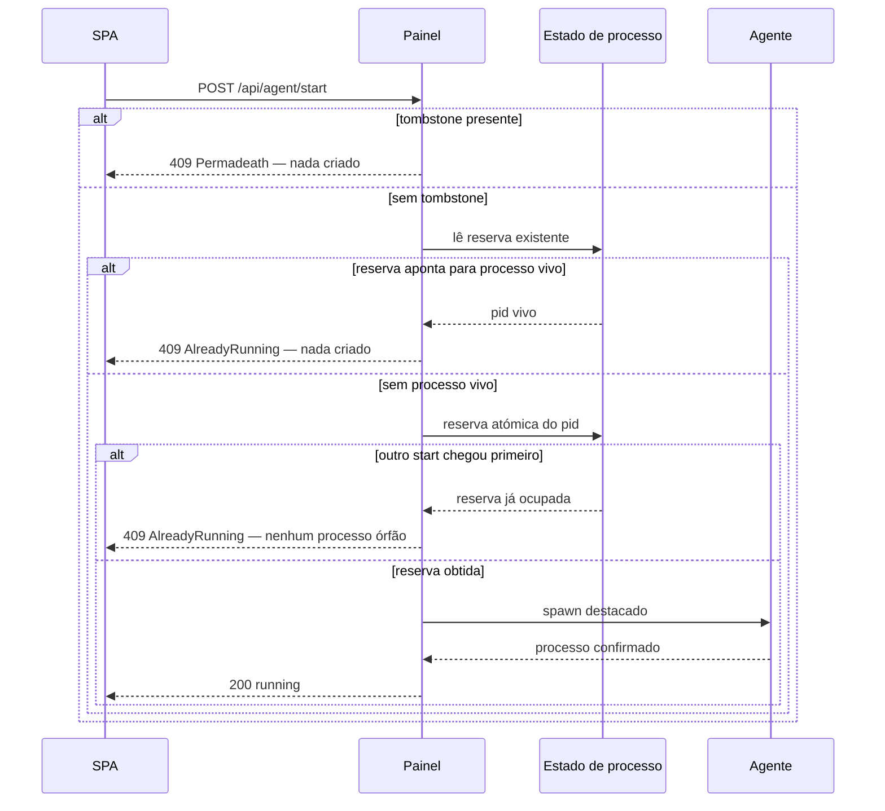
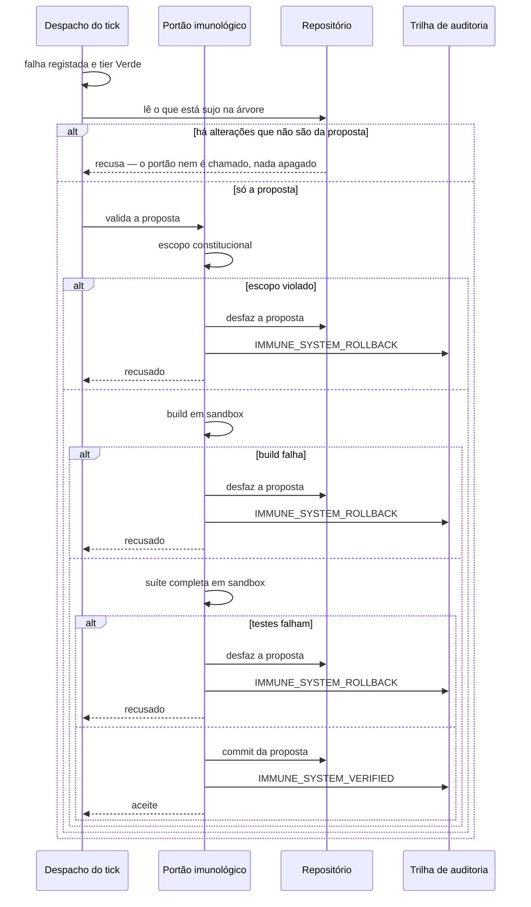

# Controle do agente, despacho dos motores e inferência free/pago

> Plan from this document. Each slice below carries its own shape - copy it, do not re-derive it.
> Status: confirmed by petersongfarias, 2026-11-09

## Situation

- Project: in active construction — o daemon, o painel e os motores existem e são testados, mas o despacho de trabalho do tick ainda é placeholder escrito como tal.
- Decision: open até esta sessão; confirmado por petersongfarias em 2026-11-09, incluindo a adição dos três motores ao mesmo trabalho. O AD-001 (observador somente leitura que nunca controla o daemon, ativo desde 08/11) é **reaberto pelo próprio autor** para o item de controle — a metade "somente leitura no SQLite" dele permanece.
- In flight: a feature Mission Control terminou e foi verificada (52/52) e nada dela é reaberto aqui; o que se copia como precedent é a regra de token e o acesso somente leitura ao banco, que ficam exatamente como estão.
- At stake: **expensive** no lado do controle — um start errado cria um segundo processo com a mesma chave privada operando o mesmo capital; barato no lado da inferência, que é configuração e reverte numa edição; **one-way** no lado da auto-modificação — o agente passa a commitar código próprio e o rollback do portão é destrutivo.

## Problem

**Item 1 — dor.** Quem dói é você, todo dia: o agente só existe com `npm start` aberto num terminal e o painel noutro, não há como desligar o agente de fora da máquina, e não há como *garantir* que ele parou — as três dores confirmadas na entrevista. O custo de não mudar é operacional e se repete a cada sessão de trabalho; o custo de mudar é que o painel deixa de ser observador puro e passa a poder matar (ou duplicar) um processo que segura chave privada. O AD-001 existia justamente para impedir a segunda instância, e é essa propriedade que tem que sobreviver à mudança, não a frase que a registrou.

**Item 2 — construção.** Não há cliente de LLM no runtime: as chaves de provedor do `.env.example` não são lidas em lugar algum, `modelClass` é rótulo derivado do tier, e o passo 5 do tick está escrito como placeholder. O que este item foi prometido destravar é exatamente o que o placeholder segura: a estimativa de probabilidade que alimenta o Quarter-Kelly e a avaliação de viabilidade das bounties. Sem ele, os dois motores seguem decidindo com tabelas `if` determinísticas. Por que agora e não depois da próxima peça: é a peça que os outros dois dependem — nenhum motor de receita roda de verdade enquanto não houver de onde tirar a estimativa.

**Três motores — construção.** Os motores existem, são testados e nunca são chamados pelo daemon: o servidor de micropagamentos não arranca, a mitose tem ponto de entrada por tick e não é invocada, e o imunológico tem o portão mas não tem quem bata nele — `ModificationProposal` nunca é criado em `src` e os diretórios que o seu escopo constitucional permite nem sequer existem no repositório. O que isto trava é a própria promessa do projeto: sem o despacho, o agente não vende análises, não se replica e não se repara a si próprio — os três ficam como suítes de teste que ninguém executa. Por que agora e não depois da próxima peça: é o mesmo ponto de despacho que os outros dois itens já tocam, e o item 2 é o que dá ao imunológico a fonte de propostas de que ele precisa para existir — ligar os motores primeiro e a inferência depois construiria o portão sem quem o acione.

**O número que custa um portão, e ele é conhecido:** uma validação do imunológico paga build mais a suíte inteira (612 testes) em sandbox, dentro de um tick de 60s — foi este número que empurrou o gatilho para o reativo, porque uma exploração agendada pagaria esse preço sem haver nada a reparar.

**O número que moveria a decisão, e ele não existe:** quantas chamadas de inferência um tick precisa. A varredura busca todos os mercados numa única resposta sem paginação e filtra por liquidez/volume, chamando o estimador uma vez por mercado, em sequência — ou seja, o custo por tick é igual ao número de candidatos que passam no filtro. Esse número é **inabsurdo de medir hoje** (não há estimador para instrumentar: ausência de instrumentação, não valor pequeno). O que se ouviu em vez de medição: a decisão de pôr **teto fixo de chamadas por tick** como trava.

## Success

- Worked if: uma semana inteira operando sem abrir terminal — start e stop pelo painel, start recusado com tombstone presente, stop esperando o tick em curso; no modo free, o agente produz estimativas reais com zero créditos gastos dentro do teto por tick; com o agente a correr, o paywall responde e uma proposta própria passa o portão de build e testes pelo menos uma vez.
- Going wrong: o primeiro tick com provedor free real estoura a cota (teto mal dimensionado); aparece um `TICK_EVALUATED` duplicado no mesmo intervalo (segunda instância criada); ou uma proposta do portão leva junto alterações suas não commitadas — este é o sinal que custa a detectar tarde.
- Review: 7 dias, petersongfarias — para o item 2, no primeiro tick com provedor free em modo pago desligado; para a auto-modificação, na primeira proposta aceite e no primeiro rollback.

## Boundary

In: start e stop do agente a partir do painel, com instância única e recusa pós-morte; modo de inferência `free`/`paid` como configuração, com fila de provedores, teto por tick e queda para o estimador determinístico; os dois consumidores que o código já prevê (estimador da Polymarket e avaliador de bounties); o estado de controle e o modo visíveis no painel; o despacho do tick para os três motores que existem e nunca são chamados — paywall x402 a arrancar com o processo, mitose avaliada por tick, e auto-modificação reativa através do portão imunológico.

Out: expor o painel fora de `127.0.0.1` — retirado pelo autor na confirmação; escolher e verificar provedores free — a busca externa estava indisponível nesta sessão, fica como configuração e spike; reinício automático quando o agente morre sozinho — o painel só inicia e para, não supervisiona continuamente; trocar de modo sem reiniciar o agente; exploração agendada de código, alterações propostas quando nada falhou — só o reativo foi escolhido; vigiar a árvore continuamente à procura de alterações alheias — o rollback do portão é destrutivo e correria sobre o seu trabalho; escrever fora do escopo constitucional que a própria Constituição fixa; alterar os tiers do metabolismo ou os artigos da Constituição.

Unchanged: o esquema SQLite e o acesso somente leitura do painel ao banco; o contrato `405` de todas as rotas existentes; a regra do token e a recusa de subir fora de localhost sem ele; os tiers e seus rótulos de `modelClass`; o estimador determinístico atual, que permanece como último degrau e nunca é removido; o SSE e as rotas `GET`; as cinco barreiras do portão imunológico e o escopo constitucional da auto-modificação, que continuam como estão; o mecanismo de desligamento na morte que o paywall e as ordens abertas já usam.

## Prior art

- Convenção de matar processo filho já usada neste repositório pelo sistema imunológico (força no Windows, sinal no resto) — **we take it** para o spawn e para o desligamento na morte, **mas ela não governa o stop**: no Windows, enviar `SIGTERM` a um processo já o encerra à força, e a key decision 3 proíbe a força, pelo que a paragem graciosa é cooperativa em todas as plataformas — o agente encerra no fim do tick, e a força fica reservada ao caminho da morte.
- Convenção de `405` com cabeçalho `Allow` já usada pelo servidor de micropagamentos — **we take it**: as rotas novas de controle passam a ser a única exceção ao `405` do painel, e o cabeçalho diz qual é.
- A limitação registrada na própria especificação do Mission Control — não há cliente de LLM no runtime — **we take it** como ponto de partida, não como restrição: é o que este item constrói.
- Pesquisa externa sobre provedores free e seus tetos: **indisponível nesta sessão** (busca falhou nas tentativas). Nenhum teto de cota é afirmado aqui como fato; o teto entra como configuração e a escolha do provedor fica como spike.

## Shape

O painel passa a ser o supervisor do agente: um estado de processo fora do banco guarda quem está vivo, e duas rotas de comando ligam e desligam o daemon sem que o painel deixe de abrir o SQLite somente leitura. A inferência passa a existir como modo de configuração (`free` ou `paid`) com uma fila ordenada de provedores, teto fixo de chamadas por tick e o estimador determinístico de hoje como último degrau, alimentando os dois avaliadores que o código já abriu. O despacho do tick passa a existir — o paywall arranca com o processo e morre com ele, a mitose é avaliada por tick só em tier Verde, e a auto-modificação corre apenas quando algo falhou, com o portão imunológico à frente de qualquer escrita — e a porta é dupla: quem quiser supervisionar o agente por outro lado migra um pid em uso, e quem puser alterações na árvore fora de uma proposta arrisca um rollback destrutivo. A alternativa mais pesada é um processo supervisor separado, com registo de saúde dos provedores e modo persistido entre reinícios, e ela só ganha se o agente tiver de ser controlável com o painel fechado ou por mais do que um cliente ao mesmo tempo.

## Key decisions

1. **O painel supervisiona o agente, e o AD-001 é trocado por esta forma: o painel pode iniciar e parar o daemon, mas continua a nunca escrever no SQLite.** O estado de controle vive fora do banco, em ficheiro de processo na raiz do trabalho — é o que preserva a prova de que o painel não toca no banco (C39) enquanto ele ganha poder sobre o processo.
2. **Instância única: `start` é recusado se o ficheiro de processo aponta para um processo vivo, e recusado se existe `tombstone.json`.** É a propriedade que o AD-001 protegia, agora garantida por reserva atómica do pid em vez de por ausência de rotas de escrita; a corrida entre dois `start` simultâneos tem de perder sem criar o segundo processo.
3. **Nunca sai com um tick em curso: `stop` pede a paragem, espera o tick terminar e só depois o agente encerra.** O sinal atual encerra imediatamente por cima do tick em voo; a paragem forçada está proibida mesmo quando o agente não responde, porque cortar uma operação a meio é exatamente o dano que o stop existe para evitar.
4. **O modo de inferência e o teto de chamadas por tick são configuração lida na arranque, e o estimador determinístico é sempre o degrau final.** O modo mora em `.env` ao lado das chaves que já lá estão, é mostrado pelo painel e trocá-lo exige reiniciar o agente — operação que este mesmo trabalho passa a permitir a partir do painel. Sem teto, a varredura sem paginação estoura qualquer cota no primeiro tick; com o determinístico por baixo, o agente nunca fica parado por falta de modelo, e a perda de provedor vira alerta no painel em vez de paragem — o valor do teto fica na fatia que o configura.
   > **Revisto em 2026-11-12 (AD-002):** o arranque passa a exigir LLM. Um preflight bloqueante pinga todos os provedores do modo; os que falham saem da fila nesse arranque, e se nenhum responder o arranque é **recusado** (`NoLLMAvailable`, saída `78`, motivo na trilha e no painel). A queda para o determinístico continua a valer **depois** de um arranque bem-sucedido, tick a tick. O modo continua a morar em `.env`, mas `POST /api/agent/start` pode sobrepô-lo só para esse arranque (`{ mode }`).
5. **A inferência é consultiva: alimenta estimativas, mas quem autoriza continua a ser o código determinístico.** O Quarter-Kelly e a trava de 5% continuam a calcular e a recusar sobre o número recebido, e o firewall anti-spam mantém os seus bloqueios duros independentes do score — nenhum modelo autoriza operação nem levanta uma submissão acima do obstáculo sozinho.
6. **Os motores morrem com o agente: o que arranca dentro do processo — o paywall x402 — pára no stop e no permadeath, pelo mecanismo de desligamento que já está registado.** É o contrato que o Artigo IV já exige e que o teste de desligamento automático já prova; o que falta é o arranque, e acionar os hooks também na paragem graciosa — hoje eles correm só dentro do permadeath, de modo que um stop normal os não alcança. Uma porta ocupada não derruba o agente: fica sem paywall e regista o motivo.
7. **O portão imunológico só corre quando o agente tem uma proposta própria, e nunca faz rollback nem commit de alterações que não sejam dessa proposta.** O rollback é destrutivo (`reset --hard` e `clean -fd`) e o commit varre a árvore inteira, e o portão faz rollback já na primeira barreira, antes de olhar para quem sujou a árvore — correr sem primeiro provar que a sujeira é só da proposta levaria o seu trabalho não commitado. Esta é a frase que o plano não derivaria por si.
8. **Proposta só quando algo falhou, e o preço de um portão longo é aceite.** O gatilho é uma falha registada, não uma agenda — build mais suíte inteira por tick de 60s sem nada a reparar não se paga; enquanto o check corre, o liveness pode dizer `STALE` e é o estado de supervisor, não o liveness, que diz se o agente está a correr.

## Work

| Slice | Delivers | Status |
|---|---|---|
| [Controle do Agente](#controle-do-agente) | Start e stop pelo painel, com instância única, recusa pós-morte e tela de controlo | clear |
| [Servidor x402](#servidor-x402) | O paywall a responder com o agente a correr, e a parar com ele | clear |
| [Mitose](#mitose) | O ciclo de vida da mitose avaliado em cada tick, só em tier Verde | clear |
| [Modo de Inferência](#modo-de-inferência) | `INFERENCE_MODE` free/pago com fila de provedores, teto por tick e queda para o determinístico | open — 3 defaults taken |
| [Estimador Polymarket](#estimador-polymarket) | `estimatedProb` vindo de um modelo real em vez da tabela `if`, dentro do teto | spike |
| [Avaliador de Bounties](#avaliador-de-bounties) | Score de viabilidade fornecido pelo modelo, com o firewall intacto | open — 2 defaults taken |
| [Auto-Modificação Imunológica](#auto-modificação-imunológica) | O agente repara-se a si próprio quando algo falha, sob o portão de build e testes | spike |

Order: Controle do Agente → Servidor x402 → Mitose → Modo de Inferência → Estimador Polymarket → Avaliador de Bounties → Auto-Modificação Imunológica. Os dois primeiros motores não dependem de mais nada; a inferência vem a seguir com os seus dois consumidores; a auto-modificação fica por último porque depende da inferência existir — sem proposta não há portão.

Already handled by existing code: o liveness derivado do último `TICK_EVALUATED` (que já mostra `STALE`/`DEAD` com o agente parado) e a visualização do `tombstone.json` na tela do clã; o desligamento na morte que o paywall e as ordens abertas já usam; as cinco barreiras do portão imunológico, o limiar e a simulação da mitose, e as rotas do paywall — tudo já escrito e testado, o que falta é o chamado.

Derivable from the repository, left to the plan: a convenção de sinal e de força em processo filho, a ordem de autenticação das rotas, a máscara `***` das chaves novas, a página e o texto das rotas — "all as the dashboard already does them"; a ordem das barreiras do portão, o limiar da mitose e as portas do paywall — "all as the existing engines do them".

### Controle do Agente

**Delivers** start e stop do daemon a partir do painel, com instância única, recusa quando o agente já morreu, e o estado de controlo visível na tela. **Status: clear.** Esta é a porta: quem quiser supervisionar por outro lado migra um pid em uso.

| State | What should happen | Caller sees |
|---|---|---|
| Painel aberto, agente parado, sem tombstone | `start` disponível | `stopped`, comando habilitado |
| `start` recebido, sem processo vivo e sem tombstone | processo criado destacado, pid reservado, agente inicia o primeiro tick | `starting` → `running` |
| `start` recebido, processo vivo | recusado, nada criado nem lido além da reserva | `409 { error: "AlreadyRunning" }` |
| `start` recebido, `tombstone.json` presente | recusado — a morte é irreversível | `409 { error: "Permadeath" }` |
| Dois `start` no mesmo instante | só um cria processo; o outro perde a corrida e não deixa órfão | o perdedor vê `409 AlreadyRunning` |
| `stop` recebido, tick em curso | paragem pedida, o estado `stopping` é gravado de imediato, o tick termina por completo, o agente encerra sozinho e só então a rota responde | a tela mostra `stopping` pela gravação imediata; a rota bloqueia até o processo sair e devolve `200 { state: "stopped" }` |
| `stop` recebido, já parado | nada a fazer | `200` com `stopped` |
| `stop` recebido, agente não responde | não é forçado; a rota continua a esperar o processo sair, sem prazo | `stopping`, sem kill |
| Agente terminou sozinho (permadeath ou sinal) | processo morto é detetado, estado volta a `stopped` | `stopped` + `liveness` continua a derivar do último tick |
| Painel reiniciado com agente vivo | readoção do processo pelo pid guardado | `running` |

`POST /api/agent/start` `{}` ou `{ "mode": "free" | "paid" }` → `200 { state: "running" }`; arranque recusado pelo preflight → `500 { error: "AgentStartFailed", reason }` (revisto 2026-11-12, AD-002)
`POST /api/agent/stop` `{}` → `200 { state: "stopped" }` — a rota bloqueia até o processo sair e pode demorar o tempo de um tick inteiro; o estado `stopping` é gravado de imediato para que a tela o mostre durante a espera.

O estado de controlo (`stopped` \| `starting` \| `running` \| `stopping` \| `unknown`) entra no snapshot existente, pelo que o SSE o atualiza sem rota de leitura nova.

```mermaid
statesDiagram-v2
    [*] --> stopped
    stopped --> starting: start aceite
    starting --> running: processo confirmado
    starting --> stopped: processo não arrancou
    running --> stopping: stop aceite
    stopping --> stopped: tick em curso terminou
    stopped --> stopped: start com pid vivo → 409
    stopped --> stopped: start com tombstone → 409
    running --> stopped: agente terminou sozinho
    stopped --> unknown: pid ilegível
    unknown --> stopped: estado resolvido
```



Alternatives considered: supervisor separado do painel — wins if the agent must be controllable while the dashboard is down or by more than one client at a time.

### Servidor x402

**Delivers** o paywall x402 a responder enquanto o agente corre, e a parar com ele. **Status: clear.** Não é uma porta nova: o que falta é o arranque.

| State | What should happen | Caller sees |
|---|---|---|
| Agente arranca com a porta livre | o paywall sobe dentro do processo | `GET /health` responde |
| Agente arranca com a porta ocupada | o paywall não sobe; o agente continua a operar | alerta no painel com o motivo; `/health` não responde |
| Stop pelo painel | o paywall desliga antes de o agente terminar | `/health` deixa de responder |
| Permadeath | desligamento pelo mecanismo já registado | `/health` deixa de responder |
| Tier AMARELO ou LARANJA | continua no ar — a tabela de tiers o permite | nada muda |
| Tier VERMELHO | o permadeath encerra os subsistemas ativos | idem |

Nenhuma rota nova: as rotas do paywall já existem e têm teste próprio; o que esta fatia entrega é o servidor estar a correr.

Alternatives considered: paywall como processo próprio, sobrevivendo ao stop do agente — wins if the analysis has to keep selling while the agent is stopped; it costs a second process for the panel to manage and orphans the teardown that already exists.

### Mitose

**Delivers** o ciclo de vida da mitose avaliado em cada tick. **Status: clear.**

| State | What should happen | Caller sees |
|---|---|---|
| Tick em tier Verde, saldo abaixo de 3× o capital inicial | nada é avaliado para execução | sem lançamento |
| Tick em tier Verde, saldo ≥ 3× o capital inicial | limite passa, a simulação de viabilidade interna corre e só executa se aprovar | lançamento no livro-razão e entrada na linhagem |
| Simulação de viabilidade não aprova | não executa, não transfere capital | registado, sem movimento nenhum |
| Tick fora de tier Verde | o ciclo devolve sem avaliar | nada muda |
| Agente-filho em tier Verde com mãe configurada | remete os royalties antes de qualquer outra coisa do tick | lançamento de royalties |

### Modo de Inferência

**Delivers** `INFERENCE_MODE` (`free` \| `paid`) lido na arranque, com fila ordenada de provedores, teto por tick e queda até o estimador determinístico. **Status: open — 3 defaults taken.**

| State | What should happen | Caller sees |
|---|---|---|
| Modo `free`, provedor responde | estimativa vem do modelo free, sem créditos gastos | snapshot: `mode: "free"`, provedor atual |
| Modo `free`, provedor sem cota/chave/fora do ar | passa ao seguinte da fila, na ordem configurada | alerta no painel com o motivo do salto |
| Fila free toda indisponível | cai no estimador determinístico e o tick continua | alerta; agente segue a operar |
| Teto por tick atingido | o resto do tick usa o determinístico, sem erro | contador de chamadas do tick no snapshot |
| Arranque, nenhum provedor do modo responde ao preflight | arranque recusado com `NoLLMAvailable`, saída `78` (AD-002) | `500 AgentStartFailed` com o motivo; alerta crítico `INFERENCE_PREFLIGHT_FAILED` |
| Arranque, parte da fila falha o preflight | os que falharam saem da fila neste arranque | alerta `INFERENCE_PROVIDER_UNAVAILABLE` por provedor; campo "Preflight de LLM" |
| Modo `paid`, chaves presentes | ramo pago é usado e a despesa é calculada a partir dos tokens reportados × preços por 1M tokens do `.env` (AD-002) | snapshot: `mode: "paid"` |
| Teto `paid`, tier AMARELO ou abaixo | o modo efetivo desce para `free` enquanto o tier não voltar a VERDE; nenhuma despesa de LLM (AD-003) | snapshot: `mode: "free"`, `ceilingMode: "paid"`; aviso `INFERENCE_MODE_DOWNGRADED` |
| Teto `paid`, fila free falha o preflight | o arranque continua; abaixo de VERDE o tick usa o determinístico (AD-003) | aviso `INFERENCE_FREE_PREFLIGHT_FAILED` |
| Modo `paid`, sem chave ou sem cota | mesma queda do modo free — degradação observável, nunca paragem | alerta |
| Modo trocado no `.env` | efeito só no próximo arranque do agente; o valor passa a ser o teto (AD-003) | painel mostra o modo efetivo e, quando diferem, o teto |
| Probabilidade devolve fora de `(0, 1)` ou não numérica | descartada, degrau seguinte da fila | alerta com o valor rejeitado |

Nenhuma tabela nova: os saltos de degrau entram na trilha de auditoria existente. As chaves novas só caem na máscara `***` se o nome delas contiver `apikey`, `token`, `secret` ou `passphrase` — `GROQ_API_KEY` é coberta, `GROQ_KEY` passaria em claro para `/api/config`, e é isso que o plano tem de garantir ao nomear as variáveis.

Alternatives considered: modo persistido no SQLite e trocável pelo painel sem reiniciar — wins if switching modes must take effect without restarting the agent; it costs a second write path into a panel that still does not write to the database.

1. Qual provedor free entra na fila — ~~default: fila vazia~~ **resolvido em 2026-11-12 (AD-002):** fila montada pelas chaves presentes no `.env`, na ordem `openrouter, groq, gemini, ollama` (`INFERENCE_FREE_ORDER`); chaves de modelo contam como ausentes; `INFERENCE_PROVIDERS` continua a ser o override.
2. Valor do teto por tick — default: `5`, conservador sob qualquer cota e o primeiro número a ajustar no primeiro tick real.
3. Registo de despesa no modo pago — ~~default: só quando o provedor reporta custo~~ **revisto em 2026-11-12 (AD-002):** custo = tokens reportados pelo provedor × preços por 1M tokens configurados no `.env`; sem divisão de tokens reportada ou sem preço, nenhum lançamento é inventado.

### Estimador Polymarket

**Delivers** `estimatedProb` vindo de um modelo real em vez da tabela `if`, sempre dentro do teto do modo. **Status: spike.**

| State | What should happen | Caller sees |
|---|---|---|
| Candidato dentro do teto | estimativa vem do modelo e alimenta o edge e o Quarter-Kelly | oportunidade com `estimatedProb` do modelo |
| Candidato fora do teto | usa o estimador determinístico de hoje | idêntico ao comportamento atual |
| Fila de provedores indisponível no meio da varredura | degrau seguinte ou determinístico, sem travar o tick | alerta |
| Modelo devolve probabilidade inválida | descartada, degrau seguinte | alerta com o valor rejeitado |
| Sem provedor configurado | ~~determinístico, como hoje~~ o arranque é recusado pelo preflight (AD-002) | o agente não arranca |

O teto é consumido por ordem de chegada dos candidatos — a ordenação por edge é impossível antes de estimar.

- Spike: um provedor free responde dentro do teto de chamadas e devolve probabilidade utilizável? — o que cada resposta muda: se sim, mantém-se a forma e ajusta-se só o teto; se não, reduz-se o número de candidatos levados ao modelo em vez de subir o teto — quando para: um tick real completo dentro do teto com estimativa de modelo registrada.

### Avaliador de Bounties

**Delivers** score de viabilidade fornecido pelo modelo, com o firewall anti-spam e os bloqueios duros intactos. **Status: open — 2 defaults taken.**

| State | What should happen | Caller sees |
|---|---|---|
| Bounty candidata dentro do teto | modelo avalia e o score entra na decisão de viabilidade | avaliação com origem do modelo |
| Fora do teto ou sem provedor | avaliador determinístico atual, sem mudança | idêntico ao comportamento atual |
| Score do modelo fora do intervalo esperado | descartado, degrau seguinte | alerta com o valor rejeitado |
| Bloqueio duro do firewall (comentário não solicitado, patch com placeholder, limite diário) | recusado sempre, qualquer que seja o score do modelo | recusa idêntica à atual |

Key decision 5 governa esta fatia: o modelo fornece o número, o firewall continua a mandar.

1. Score do modelo substitui ou soma ao determinístico — default: substitui quando é válido, o determinístico permanece como degrau final.
2. Se o modelo está indisponível, a submissão segue ou espera — default: segue com o determinístico, como hoje; a fila de bounties não é bloqueada por falta de modelo.

### Auto-Modificação Imunológica

**Delivers** o agente a reparar-se a si próprio quando algo falha, sob o portão de build e testes. **Status: spike.** Esta é a segunda porta do documento: qualquer escrita na árvore passa por aqui.

| State | What should happen | Caller sees |
|---|---|---|
| Nenhuma falha registada desde a última proposta | nenhuma proposta é gerada, o portão não corre | tick rápido, nada muda |
| Falha registada em tier Verde | proposta própria é gerada e levada ao portão | `IMMUNE_SYSTEM_VERIFIED` ou `IMMUNE_SYSTEM_ROLLBACK` na trilha |
| Falha registada fora de tier Verde | nenhuma proposta — a auto-modificação é ação de tier Verde | nada muda |
| Árvore com alterações que não são da proposta | recusa **sem rollback**: o portão nem é chamado | recusa registada, o seu trabalho continua lá |
| Proposta toca ficheiro fora do escopo constitucional | recusa e desfaz a proposta | `IMMUNE_SYSTEM_ROLLBACK` com o motivo |
| Build falha no sandbox | desfaz a proposta | idem, com o erro |
| Suíte inteira falha no sandbox | desfaz a proposta | idem, com o erro |
| Tudo passa | proposta commitada com mensagem de auditoria | `IMMUNE_SYSTEM_VERIFIED`, a revisão fica no histórico |
| Check em curso | o tick demora mais que o intervalo | liveness pode dizer `STALE`; o supervisor diz `running` |

Key decision 7 é a pré-condição desta fatia: a prova de que a árvore só está suja com a proposta acontece **antes** de o portão ser chamado, porque o portão faz rollback já na sua primeira barreira. No despacho, este bloco corre por último, depois dos motores de receita — pode demorar minutos e não deve atrasá-los.



Alternatives considered: correr o portão a cada tick como vigilância da árvore — wins if foreign modifications have to be caught automatically; it costs the rollback running over work that is not the agent's, which is why it stays out.

1. Quantas tentativas por falha — default: uma por falha distinta, e nenhuma enquanto as falhas se repetirem sem um tick bem-sucedido no meio, para não haver tempestade de build e testes.
- Spike: uma proposta gerada por modelo passa o portão de build e suíte completa? — o que cada resposta muda: se sim, o ciclo reativo funciona como está; se não, estreita-se a proposta à causa da falha registada ou o portão fica apenas como guarda — quando para: três falhas distintas, cada uma com o resultado registado na trilha.

## Migration

O painel está em uso, mas não há dados a migrar: o esquema não muda e as rotas `GET` existentes respondem igual. O que muda de contrato é o método — os testes que hoje provam `405` em qualquer coisa que não seja `GET` passam a provar `405` em tudo menos nas duas rotas de controle, e a prova de que o banco não muda de hash continua valendo sem alteração. O registo do AD-001 é atualizado para a forma nova (controle sim, escrita no banco não) na mesma altura em que as rotas entram, para que ninguém planeie a partir de uma decisão já trocada. Ordem de entrada: as rotas e o estado de controlo primeiro, depois o paywall e a mitose, que não dependem de nada, depois a inferência com os seus dois consumidores, e por fim a auto-modificação — ela depende de a inferência existir. O que um observador nota sem correr nenhum teste: com o agente a correr, a porta do paywall passa a responder; se ela estiver ocupada por outro processo, nada muda e o agente continua a operar sem paywall.

## Sources

- `.specs/STATE.md` — AD-001, a decisão reaberta e a sua data.
- `.specs/features/mission-control/plan.md` — a limitação registada de que não existe cliente de LLM no runtime, e o selo de "sem provedor de inferência configurado".
- `src/constitution.md` — Artigo III (degradação por tier), Artigo IV (permadeath irreversível) e a separação de poderes entre invariantes determinísticos e saída de modelo.
- Pesquisa externa sobre provedores free: indisponível nesta sessão; nenhuma afirmação sobre tetos de cota se apoia em fonte externa.
