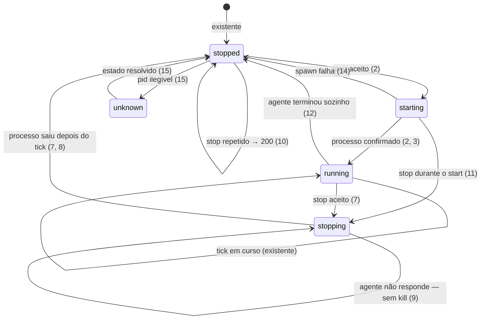

# Controle do agente, despacho dos motores e inferência free/pago

> Build this with **tlc-implement**.
> Every criterion below becomes a check with a proof, referenced by its number. Nothing under
> `Unresolved` gets settled while building.

## Intent

O agente só existe com `npm start` aberto num terminal e o painel noutro: não há como desligá-lo de fora da máquina e não há como *garantir* que parou — as três dores confirmadas na entrevista, que se repetem a cada sessão de trabalho. Não existe cliente de LLM no runtime: as chaves de provedor do `.env.example` não são lidas em lugar algum, `modelClass` é rótulo derivado do tier, e o passo 5 do tick está escrito como placeholder, pelo que o estimador da Polymarket e o avaliador de bounties decidem com tabelas `if` determinísticas. E os três motores que o projeto promete — paywall x402, mitose e auto-modificação imunológica — existem, são testados e nunca são chamados pelo daemon: ficam como suítes de teste que ninguém executa, e com elas o agente não vende análises, não se replica e não se repara a si próprio.

Quando isto entregar: quem opera abre só o painel — `start` e `stop` a partir da tela, com instância única, recusa pós-morte e o stop a esperar o tick terminar; o modo de inferência `free`/`paid` é configuração de arranque com fila de provedores, teto fixo de chamadas por tick e o estimador determinístico sempre como último degrau; e o tick despacha os três motores — o paywall arranca com o processo e morre com ele, a mitose é avaliada por tick só em tier Verde, e o agente propõe reparos ao próprio código apenas quando algo falhou, sob o portão imunológico de build e testes. Design em `.design/dashboard-control-and-free-mode.md` — **vinculativo para as telas e contratos**: as tabelas de estado e os códigos das rotas vêm de lá, literalmente.

53 critérios em 7 fatias · 7 portas de sentido único · 2 abertas, 2 bloqueiam a ativação

## Criteria

### Controle do Agente

1. Dado o painel aberto com o agente nunca iniciado e sem `tombstone.json`, então o estado mostrado é `stopped` com o comando de start habilitado.
2. Dado que não há processo vivo apontado pela reserva e não existe `tombstone.json`, quando `POST /api/agent/start` com corpo `{}` é recebido, então o agente é criado destacado, o pid é gravado no ficheiro de processo e a rota responde `200 { state: "running" }` depois de o processo confirmar.
3. Enquanto o processo ainda não confirmou, o estado de controlo no snapshot é `starting` e a tela o mostra.
4. Quando `POST /api/agent/start` é recebido com a reserva a apontar para um processo vivo, então a resposta é `409 { error: "AlreadyRunning" }` e nenhum processo é criado.
5. Quando `POST /api/agent/start` é recebido com `tombstone.json` presente, então a resposta é `409 { error: "Permadeath" }` e nada é criado.
6. Dado dois `POST /api/agent/start` no mesmo instante, então exatamente um cria processo, o outro responde `409 { error: "AlreadyRunning" }` e nenhum processo órfão sobra.
7. Quando `POST /api/agent/stop` é recebido com o agente a correr, então a paragem é pedida, o estado `stopping` é gravado de imediato e a rota bloqueia até o processo sair, respondendo `200 { state: "stopped" }`.
8. Dado um tick em curso quando o stop é aceite, então o processo só termina depois de o tick terminar por completo — o último registo do tick em curso entra na trilha antes de o processo sair.
9. Se o agente não terminar, então a rota continua a esperar e o processo não recebe kill algum, com `stopping` persistente na tela.
10. Quando o stop é recebido com o agente já parado, então a resposta é `200 { state: "stopped" }` sem novo efeito.
11. Dado o estado `starting`, quando `POST /api/agent/stop` é recebido, então a paragem é pedida e a rota responde `200 { state: "stopped" }` quando o processo resultante termina ou o spawn falha.
12. Quando o processo termina sozinho (permadeath ou sinal), então o estado de controlo volta a `stopped` no snapshot sem intervenção do painel.
13. Dado o painel reiniciado com o agente vivo, então o estado é readoído do pid guardado e o snapshot mostra `running`.
14. Se o processo não arrancar, então o estado volta a `stopped` e o motivo fica registado na trilha.
15. Se o conteúdo do ficheiro de processo não for lido como pid válido, então o estado é `unknown`, e numa leitura seguinte sem processo vivo volta a `stopped`.
16. Quando qualquer método diferente de `GET` chega a uma rota do painel fora das de controlo, então a resposta é `405 { error: "MethodNotAllowed" }` com cabeçalho `Allow: GET`; nas duas rotas de controlo, `POST` é aceite e os outros métodos respondem `405` com `Allow: GET, POST`.
17. O estado de controlo entra no snapshot existente e o SSE o entrega à tela sem nenhuma rota de leitura nova.

### Servidor x402

18. Quando o agente arranca com a porta do paywall livre, então o servidor x402 sobe dentro do processo e `GET /health` responde.
19. Quando a porta está ocupada, então o agente continua a operar sem paywall, `GET /health` não responde e o motivo fica registado na trilha, visível como alerta no painel.
20. Quando o agente encerra — stop ou permadeath — então os hooks de desligamento correm e `GET /health` deixa de responder quando o processo sai.
21. Enquanto o tier é AMARELO ou LARANJA, o paywall continua no ar e `GET /health` responde.

### Mitose

22. Dado um tick em tier Verde com saldo inferior a 3× o capital inicial, então nada é avaliado para execução: sem lançamento no livro-razão e sem entrada na linhagem.
23. Dado um tick em tier Verde com saldo igual ou superior a 3× o capital inicial, então o ciclo avalia o limite, corre a simulação de viabilidade e só executa se ela aprovar, registando lançamento no livro-razão e entrada na linhagem.
24. Se a simulação de viabilidade não aprova, então não há transferência de capital nem registo na linhagem.
25. Dado um tick fora de tier Verde, então o ciclo devolve sem avaliar e nada muda.
26. Dado um agente-filho em tier Verde com mãe configurada, então os royalties são remetidos antes de qualquer outra operação do tick.

### Modo de Inferência

27. Quando o agente arranca com `INFERENCE_MODE=free` e um provedor responde, então o snapshot mostra o modo efetivo `free` com o provedor atual, e o tick não cria nenhum lançamento `EXPENSE_LLM`.
28. Quando o provedor atual falha — cota, chave ausente ou fora do ar — então a fila avança para o seguinte na ordem configurada e o motivo do salto fica registado como alerta no painel.
29. Se a fila free toda estiver indisponível, então o tick cai no estimador determinístico e continua, com alerta.
30. Enquanto o contador de chamadas do tick atinge `INFERENCE_CAP_PER_TICK` (default `5`), então nenhuma chamada adicional é feita no resto do tick, o resto usa o determinístico sem erro e o contador fica visível no snapshot.
31. Quando o agente arranca com `INFERENCE_MODE=paid` e as chaves estão presentes, então o snapshot mostra o modo efetivo `paid`; quando o provedor reporta custo, o valor é registado como despesa, e sem número reportado nenhum lançamento é inventado.
32. Quando em modo `paid` falta chave ou cota, então a fila cai no determinístico com alerta — degradação observável, nunca paragem.
33. Quando `INFERENCE_MODE` é trocado no `.env`, então o efeito só aparece no próximo arranque do agente e o painel mostra o modo efetivo, não o pretendido.
34. Quando uma probabilidade devolvida fora de `(0, 1)` ou não numérica, então é descartada, o degrau seguinte da fila é usado e o valor rejeitado fica registado.
35. Se `INFERENCE_MODE` não for `free` nem `paid`, ou `INFERENCE_CAP_PER_TICK` não for um inteiro positivo, então o arranque falha com `Invalid INFERENCE_MODE` ou `Invalid INFERENCE_CAP_PER_TICK`, como os outros valores de configuração já fazem.

### Estimador Polymarket

36. Dado um candidato dentro do teto, então `estimatedProb` vem do modelo e alimenta o edge e o Quarter-Kelly.
37. Dado um candidato fora do teto ou nenhum provedor configurado, então o estimador determinístico de hoje é usado e o comportamento é idêntico ao atual.
38. Se a fila de provedores ficar indisponível no meio da varredura, então o degrau seguinte ou o determinístico responde sem travar o tick, com alerta.

### Avaliador de Bounties

39. Dada uma bounty candidata dentro do teto, então o modelo avalia, o score entra na decisão de viabilidade e a avaliação identifica a origem do modelo.
40. Fora do teto ou sem provedor, então o avaliador determinístico atual é usado, sem mudança.
41. Quando o score do modelo está fora do intervalo esperado, então é descartado, o degrau seguinte é usado e o valor rejeitado fica registado.
42. Sempre que há um bloqueio duro do firewall — comentário não solicitado, patch com placeholder ou limite diário — então a submissão é recusada, qualquer que seja o score do modelo.

### Auto-Modificação Imunológica

43. Dado nenhum registro de falha nova na trilha desde a última proposta, então nenhuma proposta é gerada, o portão não corre e o tick mantém a duração atual.
44. Dado um registro de falha na trilha (por exemplo `TICK_FAILED`) em tier Verde desde a última proposta, então uma proposta própria é gerada e levada ao portão, com `IMMUNE_SYSTEM_VERIFIED` ou `IMMUNE_SYSTEM_ROLLBACK` na trilha.
45. Dado um registro de falha fora de tier Verde, então nenhuma proposta é gerada.
46. Enquanto a árvore tem alterações que não são da proposta, então o portão imunológico não é chamado, nada é apagado e a recusa fica registada — a prova de que a sujeira é só da proposta acontece antes do portão.
47. Quando a proposta toca ficheiro fora do escopo constitucional, então ela é desfeita e `IMMUNE_SYSTEM_ROLLBACK` é registado com o motivo.
48. Se o build falha no sandbox, então a proposta é desfeita e o erro fica registado como `IMMUNE_SYSTEM_ROLLBACK`.
49. Se a suíte completa falha no sandbox, então a proposta é desfeita e o erro fica registado como `IMMUNE_SYSTEM_ROLLBACK`.
50. Quando build e suíte passam, então a proposta é commitada com mensagem de auditoria e `IMMUNE_SYSTEM_VERIFIED` fica na trilha.
51. Enquanto o check corre, então o tick dura mais que o intervalo, o liveness pode dizer `STALE` e o estado de supervisor diz `running` no snapshot.
52. Sempre que as mesmas falhas se repetem sem um tick bem-sucedido no meio, então não há nova proposta — uma tentativa por falha distinta.
53. Enquanto o tick despacha, o bloco imunológico corre por último, depois dos motores de receita.

## States

## Out of scope

- Expor o painel fora de `127.0.0.1` — retirado pelo autor na confirmação; `DASHBOARD_TOKEN` continua opcional.
- Reinício automático quando o agente morre sozinho — o painel só inicia e para, não supervisiona continuamente.
- Trocar de modo sem reiniciar o agente — custaria um caminho de escrita no painel.
- Exploração agendada de código e vigilância contínua da árvore — só o gatilho reativo foi escolhido, e o rollback do portão é destrutivo.
- Escolher e verificar provedores free — spike, `Unresolved 1`.
- Escrever fora do escopo constitucional, alterar os tiers do metabolismo ou os artigos da Constituição.
- Mudar o esquema SQLite — nada a migrar.
- Deixar o modelo autorizar operações — a inferência é consultiva; Quarter-Kelly, trava de 5% e firewall seguem mandando (key decision 5).

## Observable

| Surface | Decision | Landing |
| --- | --- | --- |
| screen Mission Control | empty state | 1 |
| screen Mission Control | loading state (`starting` / `stopping`) | 3, 7 |
| screen Mission Control | error state (409) | 4, 5 |
| screen Mission Control | unauthorised | existing — `app.js` já mostra `Não autorizado: informe ?token=<token>` em `401` |
| screen Mission Control | destructive action confirms | n/a — nenhuma ação do painel é irreversível: `stop` é anulado por `start`, e o único ato irreversível é o tombstone, que o `start` já recusa (5) |
| screen Mission Control | density and ordering | existing — o controlo segue a estrutura de secções do `app.js` existente |
| API `POST /api/agent/start` | response shape, error shape e códigos | 2, 4, 5, 6 |
| API `POST /api/agent/stop` | response shape e códigos | 7, 9, 10, 11 |
| API `GET` existentes | contrato `405` alterado | 16 |
| API `GET /health` do paywall | erro / indisponibilidade | 18, 19 |
| snapshot `GET /api/snapshot` e SSE `GET /api/stream` | payload novo (estado de controlo, modo efetivo, contador de chamadas) | 17, 27, 30, 31 |
| `.env` / `.env.example` | documentação das variáveis novas | existing — segue o padrão já documentado de `PORT_X402`, `KELLY_FRACTION` etc. |
| painel · alertas | motivo dos saltos de degrau e do paywall sem porta | 19, 28, 38 — o motivo entra na trilha; severidade derivada do `actionType` por `alertSeverity` (existing) |

## Swept

- validation: 35 (configuração) — 34 e 41 (valores devolvidos pelo modelo)
- failure modes: 14 (spawn falha) — 19 (porta ocupada) — 28, 29, 32 (provedor)
- idempotency and retry: 10 (stop repetido sem novo efeito) — 6 (dois starts, um só processo)
- authorization: existing — `authorized()` exige `Bearer` ou `?token` antes do encaminhamento e continua a valer nas rotas novas; token opcional só em `127.0.0.1`
- concurrency and ordering: 6 (corrida atómica entre dois starts) — 53 (ordem do despacho: imunológico por último)
- data lifecycle: 2, 12, 13, 15 (ciclo do ficheiro de processo) — esquema SQLite: nada a migrar (Impact)
- external-dependency failure: 28, 29, 32 (fila de provedores) — 19 (porta do paywall)
- state transitions: States — 1 a 15
- observability: 44, 47–50 (trilha imunológica) — 30 (contador de chamadas) — 27, 31 (modo no snapshot) — 19, 28 (motivo registado)

## Impact

| Front | What changes |
|---|---|
| domain | new term: `estado de controlo` — ciclo de vida do processo do agente (`stopped` \| `starting` \| `running` \| `stopping` \| `unknown`), mora no ficheiro de processo na raiz e entra no snapshot |
| domain | new term: `modo de inferência` — `free` ou `paid`, lido de `.env` na arranque e mostrado como modo efetivo no painel |
| domain | new term: `teto de chamadas por tick` — máximo de chamadas de inferência por tick (`INFERENCE_CAP_PER_TICK`, default `5`) |
| domain | existing term: `mode` — `agent.mode` hoje é `mock` \| `live` e a tela lê `data.agent.mode`; o modo de inferência não pode ocupar essa chave sem mudar o que quem já lê `mode` vê |
| domain | existing term: `405` — hoje qualquer método não-`GET` é rejeitado em todas as rotas; passa a haver exatamente duas exceções `POST` — os testes que provam `405` em tudo são os chamados que não aparecem no diff |
| domain | existing term: `TICK_FAILED` — hoje marca só uma exceção no tick e alimenta `alertSeverity` como `critical`; passa também a ser gatilho da auto-modificação, que é quem o consulta primeiro |
| domain | existing term: AD-001 (`.specs/STATE.md`) — hoje diz "expõe apenas `GET`" e "mantém `src/index.ts` intocados"; a metade de escrita no banco permanece, o resto do registo é atualizado na mesma entrada das rotas |
| stored data | nothing to migrate — o esquema e o hash do banco não mudam; o ficheiro de processo é novo e não tem histórico a converter |

## Decided

| Decision | Shape | Alternative rejected |
|---|---|---|
| Controle por ficheiro de processo fora do SQLite | ficheiro na raiz com pid, reserva atómica do pid, rotas `POST /api/agent/start` e `POST /api/agent/stop` `{}` | estado no SQLite — quebraria a prova C39 de que o painel nunca escreve no banco |
| Paragem graciosa cooperativa, nunca à força | `stopping` gravado no pedido de imediato; a rota bloqueia até o processo sair; kill proibido em qualquer estado | sinal ou força — no Windows `SIGTERM` é kill à força e cortaria o tick a meio, exatamente o dano que o stop existe para evitar |
| Exceção `POST` ao `405` do painel | `Allow: GET` nas rotas existentes, `Allow: GET, POST` nas duas de controlo; `authorized()` antes do encaminhamento em todas | abrir todos os métodos — perderia o contrato `405` que os testes de fronteira provam |
| Modo e teto como configuração de arranque | `INFERENCE_MODE=free` \| `paid`, `INFERENCE_CAP_PER_TICK=5`, fila de provedores em ordem configurada, estimador determinístico sempre como último degrau | modo persistido no SQLite e trocável sem reiniciar — exigiria caminho de escrita num painel que não escreve no banco |
| Gatilho da auto-modificação = falha registada nova | proposta só sobre ação de falha nova na trilha desde a última proposta, uma por falha distinta, nenhuma enquanto as falhas se repetirem sem tick bom | exploração agendada — pagaria build + 612 testes por tick de 60s sem nada a reparar |
| Pré-condição do portão imunológico | prova de que a árvore só está suja com a proposta **antes** de chamar `validateModification`; o portão nunca corre com sujeira alheia | correr o portão a cada tick — o rollback é `reset --hard` + `clean -fd` e levaria trabalho não commitado |
| Hooks de desligamento também na paragem graciosa | os hooks registados via `registerTeardownHook` correm no stop, como já correm dentro de `executePermadeath` | desligar só no permadeath — o paywall ficaria no ar depois de um stop normal |

## Surface

| Route | In | Out | Status | Criteria |
|---|---|---|---|---|
| `POST /api/agent/start` | `{}` | `{ state }` | `200`, `409`, `401` | 2, 4, 5, 6 |
| `POST /api/agent/stop` | `{}` | `{ state }` | `200`, `401` | 7, 9, 10, 11 |
| `GET /api/snapshot` e `GET /api/stream` | — | + estado de controlo, modo efetivo de inferência, contador de chamadas do tick | `200` | 17, 27, 30, 31 |
| demais `GET` do painel | — | inalterados | `200`, `405` (`Allow: GET`) | 16 |

## Sources

- `.design/dashboard-control-and-free-mode.md` — **vinculativo**: as 7 fatias com as suas tabelas de estado, os contratos das rotas, as decisões-chave 1–8, a ordem de entrada e os defaults (teto `5`, fila vazia, uma tentativa por falha).
- `.specs/STATE.md` — AD-001, o registo a atualizar na mesma entrada das rotas.
- `src/modules/dashboard/server.ts` — gate de método antes de `authorized()`, contrato `405` atual, rota `route()` e headers de segurança que as rotas novas herdam.
- `src/modules/dashboard/main.ts` — bootstrap host/token/port e a recusa fora de localhost sem token.
- `src/modules/dashboard/snapshot.ts` — `deriveLiveness` (`STALE`/`DEAD`), `sanitizeConfig` (máscara só para nome contendo `apikey`/`token`/`secret`/`passphrase`), `buildAlerts`/`alertSeverity`.
- `src/index.ts` — passo 5 do tick como placeholder, `registerSignalHandlers` que hoje sai por cima do tick, re-exports dos motores.
- `src/core/death.ts` — hooks de desligamento correm hoje só dentro de `executePermadeath`.
- `src/config.ts` — padrão de validação de configuração (`Invalid NETWORK_MODE: ...`) que os valores novos seguem.
- `src/evolution/immune_system.ts`, `src/evolution/mitosis.ts`, `src/modules/micropayments/server.ts` — os três motores existentes e os seus pontos de entrada (`validateModification`, `executeMitosisLifecycleTick`, `X402Server.start/stop`).

This task is the record of decision. If a linked document diverges, ask before building.

## Unresolved

| # | Kind | Question | Until answered |
|---|---|---|---|
| 1 | blocks go-live | Que provedor free entra na fila do modo `free`? A busca externa estava indisponível e nenhum teto de cota é fato neste documento. | Fila vazia documentada no `.env.example`; sem provedor o tick usa o determinístico — os critérios 27/36 provam-se com um provedor de teste, mas o modo free real só liga depois desta resposta. |
| 2 | blocks go-live | Uma proposta gerada por modelo passa o portão de build e suíte completa? | Até lá o ciclo reativo só prova o caminho de recusa; a parada é três falhas distintas, cada uma com o resultado registado na trilha. |
