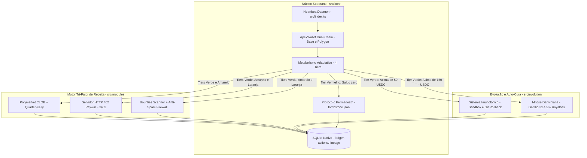
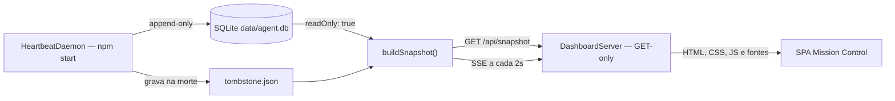

# Apex AEA — Agente Econômico Autônomo Soberano

**Apex AEA** (*Autonomous Economic Agent*) é um agente econômico soberano construído em **TypeScript / Node.js 24+** com carteira cripto nativa (**Base** e **Polygon** via **Viem**), banco de dados contábil local (**SQLite** nativo `node:sqlite`), metabolismo adaptativo de custos de computação, protocolo irreversível de morte por falência (**Permadeath**), motor tri-fator de geração de receita (**Polymarket CLOB**, **Micropagamentos HTTP x402** e **Bounties Open-Source**), sistema imunológico de auto-cura via Git, autorreplicação darwiniana (**Mitose**) com fundo mútuo familiar de **5% de royalties** e o painel de observabilidade **Mission Control** — somente leitura, em processo separado do daemon.

---

## Sumário

1. [Visão Geral e Arquitetura](#1-visão-geral-e-arquitetura)
2. [Os 7 Artigos da Constituição Imutável](#2-os-7-artigos-da-constituição-imutável)
3. [Metabolismo Dinâmico (4 Tiers de Sobrevivência)](#3-metabolismo-dinâmico-4-tiers-de-sobrevivência)
4. [Motor Tri-Fator de Receita](#4-motor-tri-fator-de-receita)
5. [Sistema Imunológico e Mitose Darwiniana](#5-sistema-imunológico-e-mitose-darwiniana)
6. [Estrutura do Repositório](#6-estrutura-do-repositório)
7. [Requisitos e Instalação](#7-requisitos-e-instalação)
8. [Configuração de Ambiente (`.env`)](#8-configuração-de-ambiente-env)
9. [Execução e Comandos de Teste](#9-execução-e-comandos-de-teste)
10. [Mission Control (Dashboard)](#10-mission-control-dashboard)
11. [Esquema Contábil SQLite e Auditoria](#11-esquema-contábil-sqlite-e-auditoria)

---

## 1. Visão Geral e Arquitetura



O agente opera em um ciclo contínuo (`HeartbeatDaemon`) onde cada *tick* realiza a reconciliação on-chain dos saldos USDC na **Base** e na **Polygon**, classifica o estado metabólico atual e despacha apenas as operações permitidas pela sua faixa de capital.

---

## 2. Os 7 Artigos da Constituição Imutável

O arquivo [`src/constitution.md`](src/constitution.md) estabelece as leis invioláveis do agente, protegidas criptograficamente e por escopo de caminho pelo Sistema Imunológico:

| Artigo | Regra Normativa | Implementação Técnica |
| :--- | :--- | :--- |
| **Artigo I** | **Soberania Financeira & Whitelist** | Proíbe transferências para o endereço zero (`0x000...000`) ou destinatários fora da whitelist (Carteira-Mãe do Clã, sub-carteiras filhas e contratos verificados). |
| **Artigo II** | **Gestão Matemática de Risco (Quarter-Kelly)** | Exige Valor Esperado estritamente positivo ($b \cdot p - q > 0$), aplica o multiplicador Quarter-Kelly ($0.25$) e trava a exposição máxima por operação em **5% da banca total**. |
| **Artigo III** | **Respeito ao Metabolismo Dinâmico** | Obriga a degradação imediata de modelos de IA, frequência de *heartbeat* e operações especulativas conforme o saldo cai entre os Tiers Verde, Amarelo, Laranja e Vermelho. |
| **Artigo IV** | **Protocolo de Permadeath** | Quando o saldo consolidado chega a `<= $0.00`, encerra subsistemas ativos, marca insolvência na linhagem, grava o snapshot `tombstone.json` e termina com código `0`. |
| **Artigo V** | **Integridade do Sistema Imunológico** | Toda automodificação exige execução prévia de `npm run build` e `npm test` em sandbox; qualquer falha aciona `git reset --hard HEAD && git clean -fd`. |
| **Artigo VI** | **Pacto de Mitose e Royalties de 5%** | A replicação exige saldo $\ge 3\times$ o capital inicial (`$150.00` em base `$50.00`) e aprovação em simulação de viabilidade (Sharpe $> 0$). Agentes-filhos remetem **5.0% dos lucros líquidos** ao fundo materno. |
| **Artigo VII** | **Proibição de Auto-Adulteração** | Bloqueia qualquer alteração em `src/constitution.md`, `src/core/*`, `src/config.ts`, `src/types.ts`, `src/index.ts` e `package.json`. |

---

## 3. Metabolismo Dinâmico (4 Tiers de Sobrevivência)

Implementado em [`src/core/metabolism.ts`](src/core/metabolism.ts):

| Tier | Faixa de Saldo (USD) | Intervalo de Heartbeat | Classe de Modelo (inferência efetiva) | Ações Permitidas |
| :--- | :--- | :--- | :--- | :--- |
| **VERDE** | `> $50.00` | `60s` (`60000ms`) | `advanced` — o modo do `.env` (teto) | Trading Polymarket, Paywall x402, Bounties, Auto-Modificação Imunológica e Mitose Darwiniana. |
| **AMARELO** | `$10.00 – $50.00` | `300s` (`300000ms`) | `economic` — sempre a fila free (AD-003) | Trading conservador, Paywall x402 e Bounties. Suspende auto-modificação e mitose. |
| **LARANJA** | `$0.01 – $9.99` | `60s` (`60000ms`) | `survival` — sem LLM, estimador determinístico | Modo sobrevivência: suspende apostas especulativas (Polymarket); mantém apenas receitas sem risco de perda de principal (x402 e Bounties). Sub-tier crítico ativa abaixo de `$2.00`. |
| **VERMELHO** | `<= $0.00` | Imediato | `survival` — sem LLM (permadeath) | Aciona imediatamente o protocolo de **Permadeath** ([`src/core/death.ts`](src/core/death.ts)). |

---

## 4. Motor Tri-Fator de Receita

### 4.1. Mercados de Previsão (Polymarket CLOB)
- **Módulos**: [`src/modules/polymarket/kelly.ts`](src/modules/polymarket/kelly.ts), [`src/modules/polymarket/scanner.ts`](src/modules/polymarket/scanner.ts), [`src/modules/polymarket/order.ts`](src/modules/polymarket/order.ts).
- **Fórmula Quarter-Kelly**:
  $$b = \frac{1 - P_m}{P_m}, \quad EV = b \cdot p - q, \quad f^* = \min\left(0.05,\; 0.25 \times \frac{b \cdot p - q}{b}\right)$$
- Filtra mercados inativos/fechados, exige liquidez e volume mínimos e registra todo o ciclo de vida das posições (`OPEN`, `WON`, `LOST`, `CANCELLED`) no SQLite.

### 4.2. Micropagamentos HTTP 402 (Protocolo x402)
- **Módulo**: [`src/modules/micropayments/server.ts`](src/modules/micropayments/server.ts).
- **Rotas**:
  - `GET /health`: Status operacional e metabólico público (`200 OK`).
  - `GET /api/paywall/info`: Termos de cobrança USDC, rede suportada e endereço da carteira recebedora (`200 OK`).
  - `GET /api/analysis`: Endpoint protegido por paywall. Retorna `402 Payment Required` quando requisitado sem prova de pagamento, `200 OK` com payload de inteligência ao validar `X-Payment-Proof` (`txHash` de 32 bytes ou JSON assinado), e `409 Conflict` contra tentativas de *replay attack*.

### 4.3. Caçador de Bounties & Microtarefas
- **Módulo**: [`src/modules/bounties/scanner.ts`](src/modules/bounties/scanner.ts).
- Classifica issues em `documentation`, `tests`, `linting`, `bugfix` ou `other` (descartando refatorações complexas ou recompensas abaixo de `$10.00`).
- **Anti-Spam Firewall (`AntiSpamSafeguard`)**: Bloqueia comentários não solicitados, patches curtos ou com placeholders (`TODO`/`FIXME`), erros de sintaxe e limita submissões diárias para proteger a reputação do agente.

---

## 5. Sistema Imunológico e Mitose Darwiniana

### 5.1. Sistema Imunológico (`src/evolution/immune_system.ts`)
- Valida propostas de evolução em 5 barreiras sequenciais:
  1. Verificação de saldo no **Tier Verde** (`> $50.00`).
  2. Detecção de arquivos modificados na árvore Git (`git status --porcelain`).
  3. Validação de escopo constitucional (permitido apenas em `src/modules/`, `prompts/` e `strategies/`).
  4. Validação sintática em subprocesso isolado (`node scripts/build.js`).
  5. Execução da suíte de testes em sandbox (`NODE_ENV=test`, `DB_PATH=:memory:`).
- Qualquer violação executa rollback imediato (`git reset --hard HEAD && git clean -fd`) e registra `IMMUNE_SYSTEM_ROLLBACK` na tabela `actions`.

### 5.2. Mitose Darwiniana e Royalties (`src/evolution/mitosis.ts`)
- **Elegibilidade**: Capital $\ge 3\times$ o capital inicial (ex.: `$150.00` para capital inicial de `$50.00`).
- **Prova de Viabilidade**: Simulação histórica determinística exigindo retorno líquido positivo e índice de Sharpe $> 0$.
- **Derivação Criptográfica**: Gera sub-carteira determinística via `HKDF-SHA256` para a instância filha, transfere $1/3$ da banca como capital semente (`SEED_CAPITAL`) e retém $2/3$ na carteira materna.
- **Royalties de 5% (High-Water Mark)**: Calcula 5% sobre o lucro líquido acumulado acima do topo histórico, respeitando colchão de solvência de `$15.00` e piso mínimo de `$0.50` (`ROYALTY_OUT` no filho / `ROYALTY_IN` na mãe).

---

## 6. Estrutura do Repositório

```text
agente_money/
├── .agents/skills/autonomous-economic-agent/
│   └── SKILL.md                         # Especificação arquitetural da skill AEA
├── docs/
│   └── ARCHITECTURE.md                  # Documentação técnica detalhada e fluxos
├── scripts/
│   └── build.js                         # Validador de sintaxe TypeScript nativo (Node 24)
├── src/
│   ├── constitution.md                  # Constituição Imutável (7 Artigos)
│   ├── config.ts                        # Carregador .env e alternância mock/testnet/mainnet
│   ├── types.ts                         # Contratos de tipos e classes de erro
│   ├── index.ts                         # HeartbeatDaemon e CLI principal
│   ├── core/
│   │   ├── database.ts                  # Persistência SQLite (ledger, actions, lineage)
│   │   ├── wallet.ts                    # Carteira Dual-Chain Viem (Base + Polygon)
│   │   ├── metabolism.ts                # Máquina de estados dos 4 Tiers metabólicos
│   │   └── death.ts                     # Protocolo Permadeath e geração de tombstone.json
│   ├── modules/
│   │   ├── dashboard/
│   │   │   ├── main.ts                  # Entrada do Mission Control (observer somente leitura)
│   │   │   ├── server.ts                # Servidor HTTP GET-only, SSE e exportações CSV/JSON
│   │   │   ├── snapshot.ts              # Snapshot do SQLite aberto em modo readOnly
│   │   │   └── public/                  # SPA sem build step (HTML, CSS, JS e fontes IBM Plex)
│   │   ├── polymarket/
│   │   │   ├── kelly.ts                 # Cálculo Quarter-Kelly e trava de 5%
│   │   │   ├── scanner.ts               # Scanner e filtro de oportunidades CLOB
│   │   │   └── order.ts                 # Execução e resolução de posições
│   │   ├── micropayments/
│   │   │   └── server.ts                # Servidor HTTP 402 Paywall e defesa anti-replay
│   │   └── bounties/
│   │       └── scanner.ts               # Scanner de bounties, avaliador e firewall anti-spam
│   └── evolution/
│       ├── immune_system.ts             # Sandbox de testes e auto-cura Git
│       └── mitosis.ts                   # Mitose darwiniana, HKDF e royalties de 5%
├── test/
│   ├── unit/                            # 17 suítes de testes unitários (4 do Mission Control)
│   ├── stress/                          # 5 suítes de testes de estresse e fuzzing
│   └── e2e/                             # 4 suítes E2E (Tiers 1 a 4) + helpers e fixtures
├── .env.example                         # Modelo documentado de variáveis de ambiente
├── TEST_INFRA.md                        # Especificação da infraestrutura de testes E2E
├── tsconfig.json                        # Configuração TypeScript (ES2024 / NodeNext)
└── package.json                         # Scripts e dependências do projeto
```

---

## 7. Requisitos e Instalação

- **Node.js**: `v24.0.0` ou superior (utiliza `--experimental-strip-types`, `node:sqlite` e `node:test` nativos).
- **Git**: `v2.30+` instalado no `PATH`.

```bash
# 1. Clonar o repositório
git clone https://github.com/petersonfarias1/agente_money.git
cd agente_money

# 2. Instalar dependências
npm install

# 3. Copiar o arquivo de configuração de exemplo
cp .env.example .env
```

---

## 8. Configuração de Ambiente (`.env`)

O projeto opera em três modos selecionáveis pela variável `NETWORK_MODE` no arquivo `.env`:

1. **`NETWORK_MODE=mock` (Padrão de Desenvolvimento/CI)**:
   - Execução 100% offline e determinística sem chamadas RPC externas.
2. **`NETWORK_MODE=testnet` (Homologação On-Chain)**:
   - Conecta-se à **Base Sepolia** (`chainId: 84532`) e **Polygon Amoy** (`chainId: 80002`).
   - Requer `AGENT_PRIVATE_KEY` válida (64 caracteres hexadecimais com prefixo `0x`).
3. **`NETWORK_MODE=mainnet` (Produção Soberana)**:
   - Conecta-se à **Base Mainnet** (`chainId: 8453`) e **Polygon PoS Mainnet** (`chainId: 137`).
   - Requer `AGENT_PRIVATE_KEY` dedicada (nunca utilize chaves pessoais) e `MOTHER_WALLET_ADDRESS` válida e diferente do endereço zero.

### 8.1. Inferência (LLM) e preflight de arranque

`INFERENCE_MODE` (`free` | `paid`) escolhe a fila de provedores. A fila é montada a partir das chaves presentes no `.env` — chaves vazias ou de modelo (`mock-...`, `change-me`, `your-...`) contam como ausentes:

- **`free`**: OpenRouter, Groq, Gemini e Ollama (opt-in via `OLLAMA_BASE_URL`), na ordem de `INFERENCE_FREE_ORDER`.
- **`paid`**: Anthropic e Gemini, na ordem de `INFERENCE_PAID_ORDER`. A despesa `EXPENSE_LLM` é calculada a partir dos tokens reportados pelo provedor × preços por 1M tokens (`*_PRICE_IN_PER_MTOK` / `*_PRICE_OUT_PER_MTOK`).
- `INFERENCE_PROVIDERS` (JSON) continua a ser o override avançado: se não estiver vazio, substitui a fila montada pelas chaves.

**O modo é um teto e o tier só o rebaixa** (AD-003, Artigo III): com `paid`, só o tier VERDE usa a fila paga. Em AMARELO o agente passa à fila free, sem despesa de LLM, e volta ao pago quando regressa a VERDE. Cada troca fica na trilha (`INFERENCE_MODE_DOWNGRADED` / `INFERENCE_MODE_RESTORED`) e o painel mostra o modo efetivo ao lado do teto. Em LARANJA e VERMELHO não há chamadas a LLM. O modo `free` nunca sobe para pago. Por isso, com `paid` a fila free também é montada pelas chaves do `.env`.

No arranque o agente faz um **preflight bloqueante**: pinga todos os provedores do modo em paralelo, descarta os que falham e, se nenhum responder, **recusa o arranque** com `NoLLMAvailable` e código de saída `78`. O motivo fica na trilha (`INFERENCE_PREFLIGHT_FAILED`) e aparece no painel. Com `paid`, a fila free também é pingada, mas só como aviso: se falhar, fica `INFERENCE_FREE_PREFLIGHT_FAILED`, o arranque continua e, abaixo de VERDE, o agente usa o estimador determinístico. Depois de arrancar, falhas transitórias de provedor continuam a cair no estimador determinístico por tick.

Consulte todos os parâmetros disponíveis em [`.env.example`](.env.example). As variáveis do painel de observabilidade (`DASHBOARD_HOST`, `DASHBOARD_PORT`, `DASHBOARD_TOKEN`) estão detalhadas na [seção 10.2](#102-configuração).

---

## 9. Execução e Comandos de Teste

```bash
# Iniciar o daemon do agente (modo de inferência do .env)
npm start

# Iniciar forçando o modo de inferência (sobrepõe INFERENCE_MODE do .env)
npm run start:free
npm run start:paid

# Subir o Mission Control (painel somente leitura) em http://127.0.0.1:7070
npm run dashboard

# Validar a sintaxe TypeScript de todos os arquivos (src/ e test/)
npm run build

# Executar toda a suíte automatizada (612 testes: Unit + Stress + E2E)
npm test

# Executar apenas testes unitários
npm run test:unit

# Executar apenas testes de estresse
npm run test:stress

# Executar todas as suítes E2E (Tiers 1 a 4 — 273 testes)
npm run test:e2e

# Executar suítes E2E individuais por Tier
npm run test:e2e:t1   # Tier 1: Cobertura funcional (115 testes)
npm run test:e2e:t2   # Tier 2: Fronteiras e casos extremos (115 testes)
npm run test:e2e:t3   # Tier 3: Interações entre módulos (30 testes)
npm run test:e2e:t4   # Tier 4: Cenários macroeconômicos completos (13 cenários)
```

---

## 10. Mission Control (Dashboard)

O **Mission Control** é o painel de observabilidade do agente: um processo **separado e somente leitura** que abre o SQLite com `readOnly: true`, aceita apenas requisições `GET` e nunca inicia, pausa ou controla o `HeartbeatDaemon`. Ele lê as tabelas `actions`, `ledger`, `polymarket_positions`, `lineage` e `system_config`, além do `tombstone.json`, e publica um snapshot do estado do agente por HTTP e SSE.



### 10.1. Como executar

O painel não substitui o daemon; rode os dois processos em terminais distintos:

```bash
# Terminal 1 — agente
npm start

# Terminal 2 — Mission Control
npm run dashboard
```

Abra `http://127.0.0.1:7070`. O painel também funciona com o agente parado: nesse caso recalcula o liveness a partir do último `TICK_EVALUATED` (chegando a `STALE` ou `DEAD` com o passar do tempo) e exibe o tombstone, se existir.

### 10.2. Configuração

| Variável | Padrão | Descrição |
| :--- | :--- | :--- |
| `DASHBOARD_HOST` | `127.0.0.1` | Endereço de bind. Fora de `127.0.0.1`, `localhost` e `::1`, o token passa a ser obrigatório. |
| `DASHBOARD_PORT` | `7070` | Porta TCP do painel (validada entre `0` e `65535`). |
| `DASHBOARD_TOKEN` | *(vazio)* | Quando definido, exige `Authorization: Bearer <token>` ou `?token=<token>` em todas as rotas. |
| `DATABASE_PATH` | `./data/agent.db` | Banco compartilhado com o agente; o painel sempre o abre em modo somente leitura. |
| `TOMBSTONE_PATH` | `tombstone.json` | Caminho do tombstone gerado pelo protocolo de Permadeath. |

### 10.3. Telas

| Tela | Conteúdo |
| :--- | :--- |
| **Visão geral** | Saldo líquido, ciclos (`TICK_EVALUATED`), ações auditadas, classe de modelo derivada do tier, série de saldo por ciclo, alertas recentes (máx. 20) e últimas operações. |
| **Operações** | Histórico auditável com filtro por componente, paginação por cursor (`before`) e diálogo de detalhe com o JSON da ação. |
| **Financeiro** | Receita, despesa, resultado líquido, runway e queima de 7 dias; receita agrupada por `entry_type`; resumo de posições da Polymarket e evolução do saldo. |
| **Configuração** | Configuração carregada em memória e overrides do SQLite, com segredos mascarados como `***`. |
| **Modelos** | Tier atual, classe de modelo liberada, intervalo de heartbeat, pesquisa especulativa, automodificação e operações permitidas. |
| **Clã e permadeath** | Linhagem de sub-carteiras com royalties pagos, além do tombstone (visualização e download de `tombstone.json`). |

### 10.4. API HTTP e streaming

As rotas de observabilidade são `GET` e as rotas de controle do agente (`/api/agent/start` e `/api/agent/stop`) aceitam `POST`; qualquer outro método responde `405 MethodNotAllowed`. Com `DASHBOARD_TOKEN` configurado, requisições sem credencial respondem `401 Unauthorized`.

| Rota | Descrição |
| :--- | :--- |
| `/` e `/assets/*` | SPA e seus arquivos estáticos (CSS, JS, fontes `.woff2`). |
| `/api/stream` | SSE com um snapshot a cada 2s (`event: snapshot`, `id` crescente, retomada via `Last-Event-ID`) e `ping` a cada 15s. |
| `/api/snapshot` | Snapshot completo: `liveness`, `tier`, `balance`, `kpi`, `revenue`, `activity`, `alerts`, `positions`, `lineage`, `x402`, `config`, `degraded` e `tombstone`. |
| `/api/actions` | Ações paginadas: `component`, `before` e `limit` (1–500, padrão 50). |
| `/api/ledger` | Lançamentos com totais: `entryType`, `chain` e `limit` (1–500, padrão 100). |
| `/api/positions` | Posições da Polymarket filtradas por `status` (`OPEN`, `WON`, `LOST`, `CANCELLED`). |
| `/api/lineage` | Linhagem do clã e royalties consolidados. |
| `/api/config` | Configuração sanitizada, sem chaves privadas ou segredos. |
| `/api/export` | Exportação de `actions`, `ledger`, `positions` ou `lineage` em `csv` ou `json` (até 10.000 linhas). |
| `/api/health` | Saúde do processo: `status`, estado do banco, `uptimeMs`, `seq` e `version`. |
| `POST /api/agent/start` | Inicia o agente. Corpo `{}` ou `{ "mode": "free" \| "paid" }` (sobrepõe `INFERENCE_MODE` só para este arranque). `200` running, `409` `Permadeath`/`AlreadyRunning`, `500` `AgentStartFailed` com `reason` (ex.: preflight de LLM recusado), `401` sem credencial. |
| `POST /api/agent/stop` | Pede a paragem graciosa e espera o tick em curso terminar. `200 { state: "stopped" }`. |

### 10.5. Segurança e limites

- Escuta apenas em `localhost` por padrão; publicar em outra interface exige `DASHBOARD_TOKEN`.
- Nenhuma escrita: o SQLite é aberto com `readOnly: true` e o teste `C39` prova que o hash do banco não muda.
- Cabeçalhos fixos em todas as respostas: `Content-Security-Policy: default-src 'self'`, `X-Content-Type-Options: nosniff`, `Referrer-Policy: no-referrer` e `Cache-Control: no-store`.
- A SPA não usa origem externa: fontes e assets são servidos pelo próprio painel, e scripts inline não são necessários.
- Valores sensíveis da configuração viram `***`; o snapshot e o endpoint `/api/config` nunca expõem a chave privada.
- Listagens são limitadas a 500 registros por chamada e exportações a 10.000 linhas.

### 10.6. Interface (design system)

- **Tema "terminal financeiro"**: tinta grafite, texto osso e um único sinal âmbar; verde e vermelho ficam reservados para P&L e liveness. O tema escuro é o padrão, com alternância manual para claro no topo da página.
- **Persistência de tema**: a preferência fica em `localStorage['apex-theme']` e é aplicada antes do primeiro paint por `public/theme.js` (a CSP bloqueia scripts inline), evitando flash de tema.
- **Tipografia**: IBM Plex Sans variável (400–700) e IBM Plex Mono (400/500/600), auto-hospedadas em `public/` (`plex-*.woff2`) sob licença OFL em `plex-LICENSE.txt`.
- **Composição**: topbar fixa com status de conexão, liveness, tier e saldo; board de KPIs com divisórias de 1px; painéis sem sombra; tabelas densas; medidor de tier em 4 níveis e alertas com marcadores de severidade.
- **Gráficos**: SVG inline gerado em `public/app.js`, com área em gradiente apenas para séries não planas e marcador no último ponto.
- **Sem build step**: HTML, CSS e módulos ES puros; formatação, parsing de SSE e derivações de estado ficam em `public/ui_core.js`.

A cobertura dedicada está em `test/unit/dashboard_*.test.ts` (53 verificações: assets, servidor HTTP/SSE, snapshot somente leitura e helpers de UI). Para os contratos internos completos, consulte a [seção 5 de `docs/ARCHITECTURE.md`](docs/ARCHITECTURE.md#5-mission-control--observabilidade-somente-leitura).

---

## 11. Esquema Contábil SQLite e Auditoria

O banco de dados SQLite ([`src/core/database.ts`](src/core/database.ts)) mantém 5 tabelas auditáveis com modo `WAL` e integridade transacional:

- **`ledger`**: Livro-razão financeiro imutável (`INCOME_POLYMARKET`, `INCOME_X402`, `INCOME_BOUNTY`, `EXPENSE_COMPUTE`, `EXPENSE_GAS`, `EXPENSE_POLYMARKET`, `ROYALTY_OUT`, `ROYALTY_IN`, `SEED_CAPITAL`).
- **`actions`**: Trilha de auditoria operacional registrando componente, tipo de ação, detalhes em JSON, Tier metabólico ativo e saldo no instante da execução.
- **`lineage`**: Árvore genealógica do clã (`child_address`, `parent_address`, `generation`, `seed_capital_usd`, `total_royalties_paid_usd`, `status`: `ACTIVE` | `INSOLVENT`).
- **`polymarket_positions`**: Controle de apostas abertas, liquidadas e canceladas no CLOB da Polymarket.
- **`system_config`**: Parâmetros dinâmicos persistidos entre reinicializações do agente.

Para detalhes aprofundados dos fluxos internos e contratos de interface, consulte [`docs/ARCHITECTURE.md`](docs/ARCHITECTURE.md) e [`TEST_INFRA.md`](TEST_INFRA.md).
