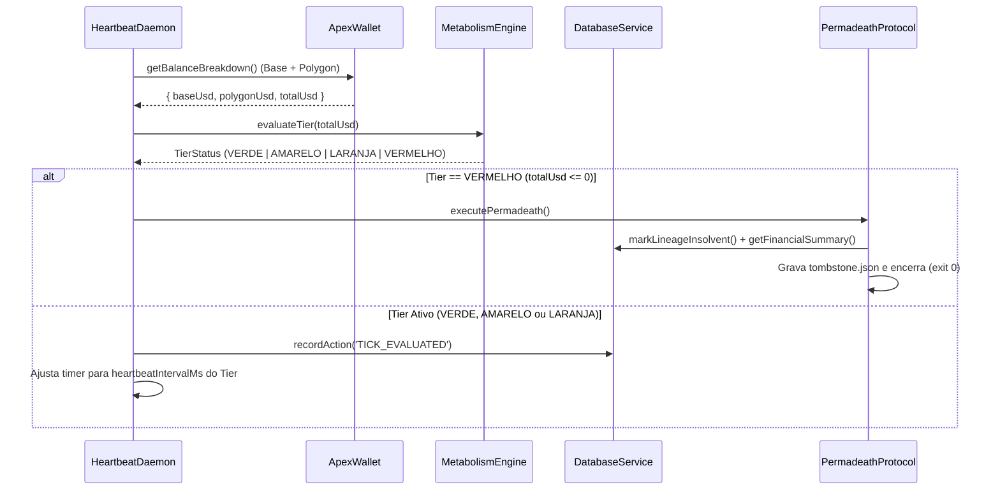

# Documentação Técnica de Arquitetura — Apex AEA

Este documento detalha os contratos internos, fluxos de dados, fórmulas matemáticas e garantias de segurança do **Apex Autonomous Economic Agent (Apex AEA)**.

---

## 1. Fluxo de Vida do Daemon (`HeartbeatDaemon`)

O ciclo de vida principal reside em [`src/index.ts`](../src/index.ts) e coordena todos os subsistemas sem concorrência destrutiva através de trava de reentrância (`isTickRunning`):

---

## 2. Carteira Cripto Dual-Chain e Governança (`ApexWallet`)

Implementada em [`src/core/wallet.ts`](../src/core/wallet.ts), a carteira opera sobre a biblioteca **Viem** com suporte nativo a **Base** e **Polygon**:

- **Precisão Decimal de 6 Casas (USDC)**:
  - `toUsdcUnits(amountUsd)`: Converte valores USD em ponto flutuante para unidades atômicas `bigint` ($1\text{ USDC} = 10^6\text{ unidades}$), rejeitando valores negativos, `NaN`, `Infinity` ou frações sub-atômicas (`< 0.000001`).
  - `fromUsdcUnits(units)`: Converte `bigint` de volta para número USD com precisão de 6 casas decimais.
- **Firewall Constitucional de Transferências (`validateTransfer`)**:
  1. Verifica formato hexadecimal de 20 bytes (`0x` + 40 dígitos hexadecimais) de forma *case-insensitive*.
  2. Bloqueia incondicionalmente o endereço zero (`0x0000000000000000000000000000000000000000`) com `ConstitutionViolationError`.
  3. Verifica presença do destinatário na `whitelist` interna; caso ausente, lança `ConstitutionViolationError` antes de qualquer assinatura criptográfica.
  4. Verifica saldo suficiente na rede de origem (`base` ou `polygon`); caso insuficiente, lança `InsufficientBalanceError`.

---

## 3. Matemática do Motor de Receita

### 3.1. Critério de Kelly Fracionário (`src/modules/polymarket/kelly.ts`)

Dado o preço de mercado $P_m \in (0, 1)$, a probabilidade estimada pelo modelo $p \in (0, 1)$ e o complemento $q = 1 - p$:

1. **Odds Líquidas ($b$)**:
   $$b = \frac{1 - P_m}{P_m}$$
2. **Valor Esperado ($EV$)**:
   $$EV = b \cdot p - q$$
   - Se $EV \le 0$, a aposta é **rejeitada** com `REJECTED_NON_POSITIVE_EV` e `stakeAmountUsd = 0`.
3. **Fração de Kelly Bruta ($f_{raw}$) e Quarter-Kelly ($f_{0.25}$)**:
   $$f_{raw} = \frac{EV}{b}, \qquad f_{0.25} = 0.25 \times f_{raw}$$
4. **Trava Constitucional de 5% da Banca ($f_{alloc}$)**:
   $$f_{alloc} = \min(0.05,\; f_{0.25})$$
5. **Piso Mínimo de Execução**:
   - Se o valor em dólares resultante $S = B \times f_{alloc}$ for inferior ao piso operacional (`minOrderUsd`, padrão `$1.00`), a ordem é rejeitada com `REJECTED_BELOW_MIN_ORDER_FLOOR`.

### 3.2. Servidor de Micropagamentos x402 (`src/modules/micropayments/server.ts`)

- Suporta bind em portas TCP ou *Named Pipes* / *Unix Domain Sockets* (`pipePath`) para testes herméticos em ambientes Windows e Linux.
- Aceita provas de pagamento via:
  - Header `X-Payment-Proof: 0x<64_hex_chars>`
  - Header `X-Payment-Proof: {"txHash":"0x...","payer":"0x...","chain":"base"}`
  - Header `Authorization: Bearer 0x<64_hex_chars>`
- **Prevenção de Replay Attack**: Verifica tanto o cache em memória quanto a coluna `tx_hash` na tabela `ledger` do SQLite antes de liberar o conteúdo pago.

### 3.3. Avaliador de Bounties e Firewall Anti-Spam (`src/modules/bounties/scanner.ts`)

- **Pontuação Ponderada de Viabilidade (`BountyEvaluator.evaluate`)**:
  $$\text{Score} = 0.30 \cdot S_{\text{dificuldade}} + 0.30 \cdot S_{\text{categoria}} + 0.20 \cdot S_{\text{clareza}} + 0.20 \cdot S_{\text{compatibilidade}}$$
- **Lucro Líquido Esperado**:
  $$\text{NetProfit} = \text{Reward}_{\text{USD}} - (\text{EstimatedTokensCost}_{\text{USD}} + \text{ComputeOverhead}_{\text{USD}})$$
- Bounties com dificuldade `hard`, lucro líquido $\le 0$ ou `score < 0.70` são descartadas automaticamente.

---

## 4. Sistema Imunológico e Mitose Darwiniana

### 4.1. Proteção de Escopo e Anti-Path Traversal (`src/evolution/immune_system.ts`)

O método `verifyConstitutionalScope(files)` normaliza cada caminho com `path.resolve(this.projectRoot, rawFile)` e verifica:
1. Se o arquivo escapa da raiz do projeto (`..`) ou usa caminho absoluto externo.
2. Se coincide com qualquer caminho listado em `DEFAULT_PROTECTED_PATHS` (`src/constitution.md`, `src/core/`, `src/config.ts`, `src/types.ts`, `src/index.ts`, `package.json`, `tsconfig.json`).
3. Se está estritamente contido nos diretórios autorizados (`src/modules/`, `prompts/`, `strategies/`).

### 4.2. Mitose e Royalties por High-Water Mark (`src/evolution/mitosis.ts`)

1. **Particionamento de Capital na Mitose**:
   - Quando $B \ge 3 \times C_{\text{inicial}}$:
     $$\text{Seed}_{\text{filho}} = \frac{1}{3} B, \qquad \text{Retido}_{\text{mãe}} = \frac{2}{3} B$$
2. **Derivação Determinística de Sub-Carteira**:
   - Utiliza `crypto.hkdfSync('sha256', parentKeyBytes, salt, info, 32)` com domínio `APEX-AEA-MITOSIS-SUBWALLET-V1` para gerar chaves privadas secp256k1 válidas e determinísticas por geração e índice de filho.
3. **Cálculo de Royalties por High-Water Mark**:
   $$\text{TotalRoyaltiesDue} = 0.05 \times \max(0,\; \text{LucroLíquidoAcumulado})$$
   $$\text{PendingRoyalty} = \max(0,\; \text{TotalRoyaltiesDue} - \text{TotalRoyaltiesPaid})$$
   - A remessa só é executada quando $\text{PendingRoyalty} \ge \$0.50$ e o saldo pós-remessa permanece $\ge \$15.00$ (colchão de solvência).
