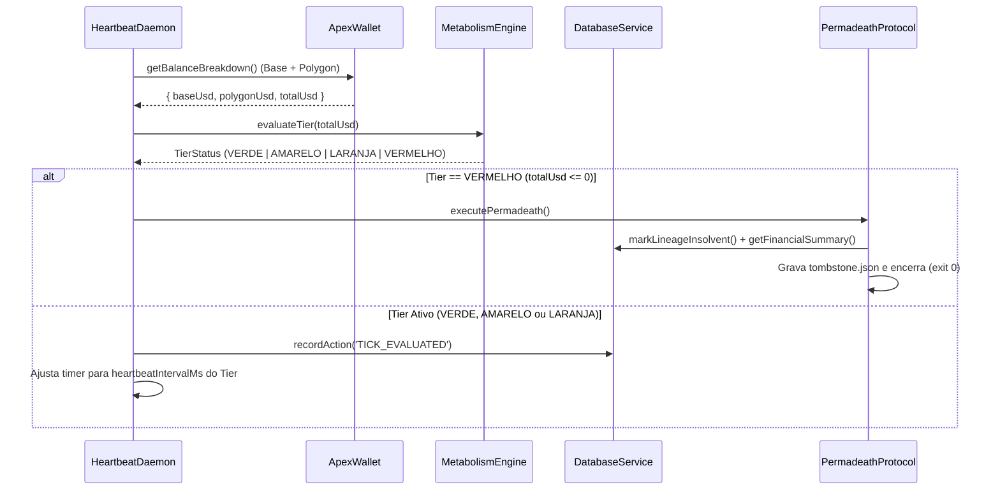
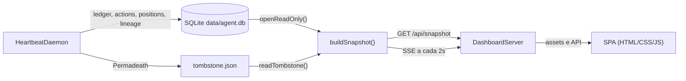

# Documentação Técnica de Arquitetura — Apex AEA

Este documento detalha os contratos internos, fluxos de dados, fórmulas matemáticas e garantias de segurança do **Apex Autonomous Economic Agent (Apex AEA)**.

---

## 1. Fluxo de Vida do Daemon (`HeartbeatDaemon`)

O ciclo de vida principal reside em [`src/index.ts`](../src/index.ts) e coordena todos os subsistemas sem concorrência destrutiva através de trava de reentrância (`isTickRunning`):

---

## 2. Carteira Cripto Dual-Chain e Governança (`ApexWallet`)

Implementada em [`src/core/wallet.ts`](../src/core/wallet.ts), a carteira opera sobre a biblioteca **Viem** com suporte nativo a **Base** e **Polygon**:

- **Precisão Decimal de 6 Casas (USDC)**:
  - `toUsdcUnits(amountUsd)`: Converte valores USD em ponto flutuante para unidades atômicas `bigint` ($1\text{ USDC} = 10^6\text{ unidades}$), rejeitando valores negativos, `NaN`, `Infinity` ou frações sub-atômicas (`< 0.000001`).
  - `fromUsdcUnits(units)`: Converte `bigint` de volta para número USD com precisão de 6 casas decimais.
- **Firewall Constitucional de Transferências (`validateTransfer`)**:
  1. Verifica formato hexadecimal de 20 bytes (`0x` + 40 dígitos hexadecimais) de forma *case-insensitive*.
  2. Bloqueia incondicionalmente o endereço zero (`0x0000000000000000000000000000000000000000`) com `ConstitutionViolationError`.
  3. Verifica presença do destinatário na `whitelist` interna; caso ausente, lança `ConstitutionViolationError` antes de qualquer assinatura criptográfica.
  4. Verifica saldo suficiente na rede de origem (`base` ou `polygon`); caso insuficiente, lança `InsufficientBalanceError`.

---

## 3. Matemática do Motor de Receita

### 3.1. Critério de Kelly Fracionário (`src/modules/polymarket/kelly.ts`)

Dado o preço de mercado $P_m \in (0, 1)$, a probabilidade estimada pelo modelo $p \in (0, 1)$ e o complemento $q = 1 - p$:

1. **Odds Líquidas ($b$)**:
   $$b = \frac{1 - P_m}{P_m}$$
2. **Valor Esperado ($EV$)**:
   $$EV = b \cdot p - q$$
   - Se $EV \le 0$, a aposta é **rejeitada** com `REJECTED_NON_POSITIVE_EV` e `stakeAmountUsd = 0`.
3. **Fração de Kelly Bruta ($f_{raw}$) e Quarter-Kelly ($f_{0.25}$)**:
   $$f_{raw} = \frac{EV}{b}, \qquad f_{0.25} = 0.25 \times f_{raw}$$
4. **Trava Constitucional de 5% da Banca ($f_{alloc}$)**:
   $$f_{alloc} = \min(0.05,\; f_{0.25})$$
5. **Piso Mínimo de Execução**:
   - Se o valor em dólares resultante $S = B \times f_{alloc}$ for inferior ao piso operacional (`minOrderUsd`, padrão `$1.00`), a ordem é rejeitada com `REJECTED_BELOW_MIN_ORDER_FLOOR`.

### 3.2. Servidor de Micropagamentos x402 (`src/modules/micropayments/server.ts`)

- Suporta bind em portas TCP ou *Named Pipes* / *Unix Domain Sockets* (`pipePath`) para testes herméticos em ambientes Windows e Linux.
- Aceita provas de pagamento via:
  - Header `X-Payment-Proof: 0x<64_hex_chars>`
  - Header `X-Payment-Proof: {"txHash":"0x...","payer":"0x...","chain":"base"}`
  - Header `Authorization: Bearer 0x<64_hex_chars>`
- **Prevenção de Replay Attack**: Verifica tanto o cache em memória quanto a coluna `tx_hash` na tabela `ledger` do SQLite antes de liberar o conteúdo pago.

### 3.3. Avaliador de Bounties e Firewall Anti-Spam (`src/modules/bounties/scanner.ts`)

- **Pontuação Ponderada de Viabilidade (`BountyEvaluator.evaluate`)**:
  $$\text{Score} = 0.30 \cdot S_{\text{dificuldade}} + 0.30 \cdot S_{\text{categoria}} + 0.20 \cdot S_{\text{clareza}} + 0.20 \cdot S_{\text{compatibilidade}}$$
- **Lucro Líquido Esperado**:
  $$\text{NetProfit} = \text{Reward}_{\text{USD}} - (\text{EstimatedTokensCost}_{\text{USD}} + \text{ComputeOverhead}_{\text{USD}})$$
- Bounties com dificuldade `hard`, lucro líquido $\le 0$ ou `score < 0.70` são descartadas automaticamente.

---

## 4. Sistema Imunológico e Mitose Darwiniana

### 4.1. Proteção de Escopo e Anti-Path Traversal (`src/evolution/immune_system.ts`)

O método `verifyConstitutionalScope(files)` normaliza cada caminho com `path.resolve(this.projectRoot, rawFile)` e verifica:
1. Se o arquivo escapa da raiz do projeto (`..`) ou usa caminho absoluto externo.
2. Se coincide com qualquer caminho listado em `DEFAULT_PROTECTED_PATHS` (`src/constitution.md`, `src/core/`, `src/config.ts`, `src/types.ts`, `src/index.ts`, `package.json`, `tsconfig.json`).
3. Se está estritamente contido nos diretórios autorizados (`src/modules/`, `prompts/`, `strategies/`).

### 4.2. Mitose e Royalties por High-Water Mark (`src/evolution/mitosis.ts`)

1. **Particionamento de Capital na Mitose**:
   - Quando $B \ge 3 \times C_{\text{inicial}}$:
     $$\text{Seed}_{\text{filho}} = \frac{1}{3} B, \qquad \text{Retido}_{\text{mãe}} = \frac{2}{3} B$$
2. **Derivação Determinística de Sub-Carteira**:
   - Utiliza `crypto.hkdfSync('sha256', parentKeyBytes, salt, info, 32)` com domínio `APEX-AEA-MITOSIS-SUBWALLET-V1` para gerar chaves privadas secp256k1 válidas e determinísticas por geração e índice de filho.
3. **Cálculo de Royalties por High-Water Mark**:
   $$\text{TotalRoyaltiesDue} = 0.05 \times \max(0,\; \text{LucroLíquidoAcumulado})$$
   $$\text{PendingRoyalty} = \max(0,\; \text{TotalRoyaltiesDue} - \text{TotalRoyaltiesPaid})$$
   - A remessa só é executada quando $\text{PendingRoyalty} \ge \$0.50$ e o saldo pós-remessa permanece $\ge \$15.00$ (colchão de solvência).

---

## 5. Mission Control — Observabilidade Somente Leitura

O **Mission Control** ([`src/modules/dashboard/`](../src/modules/dashboard/)) é um processo independente do daemon. Ele observa o estado persistido do agente e nunca participa do ciclo de vida: não cria instâncias do daemon, não agenda heartbeats e não abre o SQLite para escrita. A decisão arquitetural está registrada em `.specs/STATE.md` (AD-001).

### 5.1. Fronteira de processo e leitura

- **Entrada**: [`main.ts`](../src/modules/dashboard/main.ts) lê `DASHBOARD_HOST` (padrão `127.0.0.1`), `DASHBOARD_PORT` (padrão `7070`), `DASHBOARD_TOKEN`, `DATABASE_PATH` (padrão `./data/agent.db`) e `TOMBSTONE_PATH` (padrão `tombstone.json`).
- **Guardas de inicialização**: porta fora de `0–65535` encerra com código `1`; host fora de `127.0.0.1`/`localhost`/`::1` sem `DASHBOARD_TOKEN` encerra com código `1`.
- **Leitura estrita**: toda consulta passa por `openReadOnly(dbPath)`. O teste `C39` tenta criar uma tabela pela conexão e prova que o hash do arquivo permanece idêntico.
- **Independência do daemon**: com o daemon parado, o painel continua respondendo a partir do último estado persistido e recalcula o liveness (`ALIVE`, `STALE`, `DEAD` ou `UNKNOWN`) pelo tempo decorrido desde o último `TICK_EVALUATED`.

### 5.2. Pipeline do snapshot (`snapshot.ts`)

`buildSnapshot(state, options)` incrementa `state.seq` e monta, em uma única leitura, o objeto consumido pela SPA:

| Campo | Origem / regra |
| :--- | :--- |
| `generatedAt`, `seq` | Relógio da chamada e contador monotônico usado pelo SSE (`id`). |
| `networkMode`, `agent` | Configuração resolvida; `agent` prefere os dados do tombstone, quando presente e válido. |
| `liveness` | Derivado do último `TICK_EVALUATED` e do intervalo do tier (ver 5.3). |
| `tier` | `evaluateTier(lastBalanceUsd, thresholds, intervals)`; `null` quando não há saldo registrado. |
| `balance` | `balance_usd` da ação mais recente; `source: 'last-action'` ou `'none'`. |
| `kpi` | Contagens de ciclos (`TICK_EVALUATED`), ações, componentes distintos e alertas críticos. |
| `revenue` | Totais de receita/despesa, queima de 7 dias, runway, agrupamento por `entry_type` e série de saldo. |
| `activity` | Últimas 10 ações, contagem por componente e transições de tier. |
| `alerts` | Alertas derivados de ações recentes, com severidade `info`, `warning` ou `critical`. |
| `positions`, `lineage` | Resumo e itens da Polymarket; linhagem do clã e royalties pagos. |
| `x402`, `degraded` | Probe do servidor x402 e motivos de degradação (ex.: `degraded.x402 = timeout`). |
| `config` | Configuração sanitizada; nomes sensíveis são substituídos por `***`. |
| `tombstone` | `{ present, invalid?, path, reason, deathTimestamp, ... }` lido do disco. |

Limites de leitura por snapshot: 200 ações, 5.000 lançamentos de ledger, 500 posições, linhagem completa e série de saldo reduzida a no máximo **240 pontos** por `capSeries()`.

### 5.3. Derivação de liveness (`deriveLiveness`)

| Estado | Condição |
| :--- | :--- |
| `UNKNOWN` | Nenhum `TICK_EVALUATED` registrado e a última ação não é `PERMADEATH_EXECUTED`. |
| `DEAD` | Última ação é `PERMADEATH_EXECUTED` ou o último tick tem mais de 15 minutos. |
| `STALE` | Idade do último tick maior que `2 × heartbeatIntervalMs` do tier atual. |
| `ALIVE` | Idade do último tick dentro de `2 × heartbeatIntervalMs`. |

### 5.4. Superfície HTTP e SSE (`server.ts`)

- **Somente GET**: qualquer outro método responde `405 MethodNotAllowed` antes do roteamento.
- **Autenticação opcional**: com `DASHBOARD_TOKEN`, aceita `Authorization: Bearer <token>` ou `?token=<token>`; caso contrário responde `401 Unauthorized`.
- **Rotas**: `/`, `/assets/*`, `/api/stream`, `/api/snapshot`, `/api/actions`, `/api/ledger`, `/api/positions`, `/api/lineage`, `/api/config`, `/api/export` e `/api/health`.
- **Validação de parâmetros**: `limit` entre 1 e 500, `before` inteiro positivo, `entryType` restrito aos tipos do ledger, `chain` restrita a `base`/`polygon`, `status` restrito a `OPEN`/`WON`/`LOST`/`CANCELLED`, `table` restrita à whitelist de exportação e `format` a `csv`/`json`. Violações respondem `400 InvalidParameter`.
- **SSE**: envia `id: <seq>`, `event: snapshot` e o JSON do snapshot a cada 2s; `: ping` a cada 15s. O cabeçalho `Last-Event-ID` (ou `?lastEventId=`) retoma a sequência sem regredir o contador.
- **Exportação**: até 10.000 linhas por tabela, com `Content-Disposition` de anexo; CSV em UTF-8 com BOM e linhas CRLF.
- **Cabeçalhos**: `Content-Security-Policy: default-src 'self'`, `X-Content-Type-Options: nosniff`, `Referrer-Policy: no-referrer` e `Cache-Control: no-store` em todas as respostas.
- **Assets**: servidos de `public/` com `path.basename()` como contenção contra path traversal e `Content-Type` explícito (`text/css`, `text/javascript`, `font/woff2`, `font/woff`, `image/svg+xml`).

### 5.5. SPA e design system

- **Sem build step**: `index.html`, `styles.css` e módulos ES (`app.js`, `ui_core.js`, `theme.js`) são servidos diretamente. `ui_core.js` concentra funções puras (formatação pt-BR, parsing de SSE, `overviewModel`, `detailView`, `listState`, `downsample`, `reconnectDelay`) testadas fora do navegador.
- **Tema**: o padrão é escuro (tinta grafite, texto osso, sinal âmbar); o tema claro é uma variante de tokens em `[data-theme="light"]`, acionada manualmente no topo. `theme.js` roda no `<head>` antes da folha de estilo para aplicar a preferência salva em `localStorage['apex-theme']` sem flash; a CSP impede a solução inline.
- **Tipografia e assets**: IBM Plex Sans variável (400–700) e IBM Plex Mono (400/500/600) auto-hospedadas em `public/` (`plex-*.woff2`), com a licença OFL em `plex-LICENSE.txt`. Nenhuma fonte ou script vem de origem externa.
- **Composição**: topbar fixa com conexão, liveness, tier, saldo e alternância de tema; sidenav fixa com as seis telas; board de KPIs com divisórias de 1px; painéis planos; tabelas densas; medidor de tier em quatro níveis; alertas com marcadores de severidade.
- **Gráficos**: SVG inline gerado em `app.js` a partir de `revenue.series`; a área em gradiente só é desenhada para séries não planas, com linha e marcador no último ponto. O `viewBox` acompanha a largura medida do painel e é recalculado em redimensionamentos.
- **Estado no cliente**: `app.js` mantém o último snapshot recebido, aplica cada frame SSE (`applySnapshot`) e mantém a reconexão com backoff (`2s → 4s → 8s → 16s → 30s`).
- **Cobertura**: `test/unit/dashboard_assets.test.ts` (inventário e ausência de origem externa), `dashboard_server.test.ts` (HTTP/SSE, autenticação, exportação e fronteira read-only), `dashboard_snapshot.test.ts` (derivações e snapshot) e `dashboard_ui_core.test.ts` (helpers puros).

Instruções de execução, variáveis de ambiente e detalhes de cada tela estão na [seção 10 do README](../README.md#10-mission-control-dashboard).
